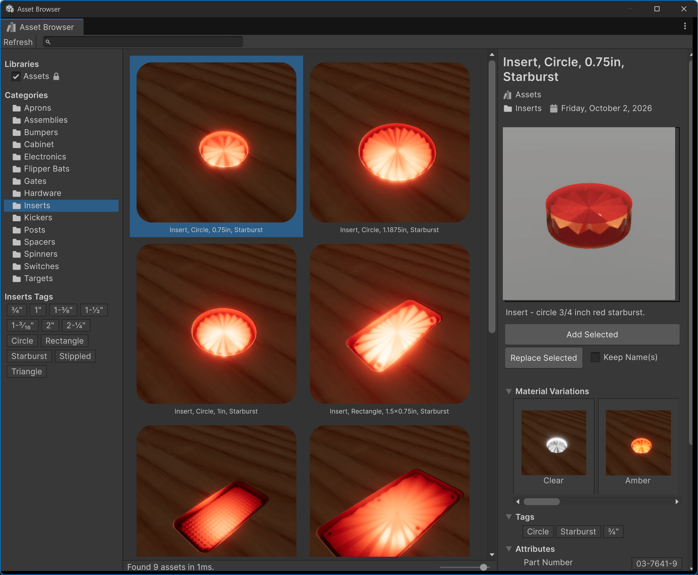
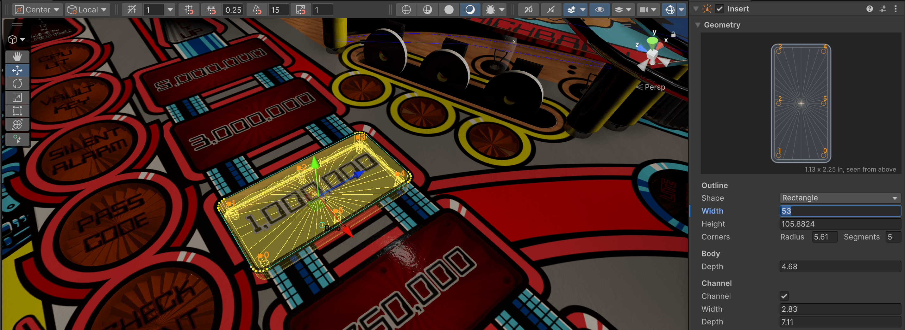
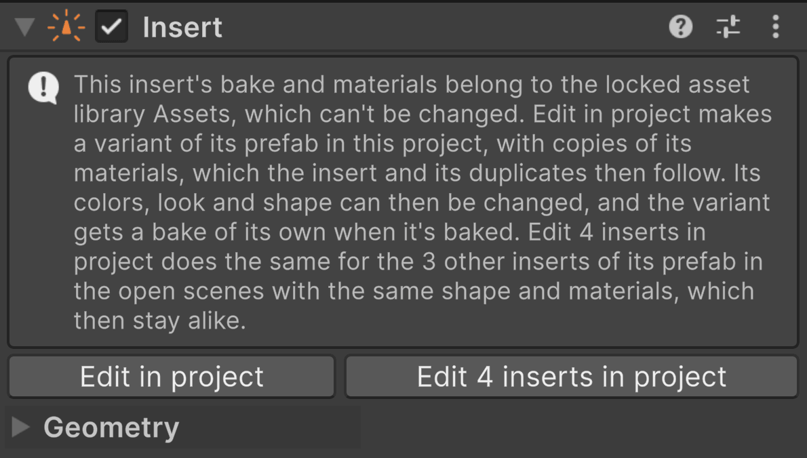
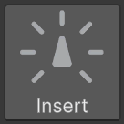

# Working with inserts

The easiest way to get an insert is the [Asset Library](xref:asset_library). It contains most common insert shapes and sizes, in several colors each, already baked, with their lamp and spill light set up. Open it with *Asset Browser* in the toolbox, drag the insert you want into your table, and align its rim with the opening in the playfield.

Then connect its lamp in the [*Lamp Manager*](xref:lamp_manager), as described under [Mapping](xref:insert_lighting#mapping). That's all a library insert needs.

However, you might have different cut-outs in your playfield that don't exactly fit, or [shape](xref:insert_geometry)/[pattern](xref:insert_patterns) combinations that aren't in the asset library. Or maybe you want to tweak the look, the color or the way the bulb is rendered. This section walks you through the basics, with links to more detailed documentation as we go.

## Modifying inserts

One important fact to understand before we go any further is that the asset library is installed as a **read-only package** that can't be changed, and so are its materials and presets. That means if you drop an insert from the asset library into your scene, the parameters of its materials (where you customize the look) are grayed out.

What's not grayed out are the parameters of the insert's *geometry*. But if you change those, the mesh becomes a yellow wireframe in the scene view and disappears entirely in the game view. Why?

The parameters of the insert geometry you're seeing in the screenshot above are not grayed out, because inserts from the asset library are [prefabs](https://docs.unity3d.com/6000.6/Documentation/Manual/Prefabs.html). Dropping a prefab into your scene creates an *instance* of it, which follows the prefab, and Unity lets you [override](https://docs.unity3d.com/6000.6/Documentation/Manual/PrefabInstanceOverrides.html) the parameters of the instance's components. An override only applies to that one instance. The insert's geometry parameters are such component parameters, but its material properties are **not**: they're stored in a separate file, which every insert wearing that material shares.

So, why is there a yellow wireframe? Well, the insert's geometry is turned into texture maps that its material reads, in a step called [baking](xref:insert_baking). The baked maps fit exactly one geometry, so if the geometry changes, they don't fit anymore. Until the insert is baked again, you see the new geometry as a yellow wireframe instead. Baking needs Blender installed, and the asset library's baked maps can't be overwritten, so the insert first needs a copy of its own. That's what the next section is about.

> [!NOTE]
> If you just want to apply another color to an existing insert without having to place and wire it again, you have a couple of options:
>
> - **Apply another color preset** - Inserts come with a [preset](xref:insert_presets) system, which you can use to quickly apply a different color: click one of the color squares under *Presets* on the Insert component. This works on inserts from the asset library too.
> - **Replace the prefab** - The asset library has a *Replace Selected* button, which replaces the entire prefab and re-assigns references to the new prefab. Select your insert in the scene, find the same insert in the asset library, and replace the selected insert with the variation of your choice.
> - **Swap the material manually** - Inserts in the asset library are organized by folders, and all materials in one folder work with the insert of that folder. If you click on the material slot of your insert (under *Materials* in the *Mesh Renderer* component), the project window of the Unity editor jumps to the folder where you'll see the other materials you can apply to the insert. Just drag the new material from the project window into the same slot as the old material.

## Forking an insert

If none of the available colors is suited for your insert, or if you want to change its geometry, you'll need to "fork" the insert: create a new [prefab variant](https://docs.unity3d.com/6000.6/Documentation/Manual/PrefabVariants.html) of it in your project, which you can modify. The variant gets copies of the insert's materials, and the insert becomes an instance of the variant instead of the asset library's prefab. It keeps its position, its lamp and its other settings.

As long as an insert can't be modified, the top of its Insert component offers two buttons to fork it:

- *Edit in project* forks the insert and only makes the selected insert an instance of the fork. Choose this when the insert you're about to fork is a new one that you've just added to the table.
- *Edit {n} inserts in project* also forks the insert, but makes all identical inserts in your scene (same prefab, geometry and materials) instances of the fork. Choose this when the insert already has copies in the scene that you'd like to include in your future modifications.

> [!NOTE]
> This choice can only be made when forking, because at that moment, the insert is still the same as the other instances of the asset library's prefab, whereas afterwards, it differs and thus can't be automatically matched with the other inserts anymore.

After forking, the variant works like any other prefab: when you duplicate the insert, the duplicate is an instance of the variant too, and when you change the variant, all its instances change with it. The fork keeps using the asset library's baked maps until you bake it for the first time, which gives it maps of its own.

With several inserts selected, *Edit {n} selected inserts in project* forks each group of them that comes from the same prefab and still has the same geometry and materials.

## Material changes

You can change the color of an insert by clicking on a color square under *Presets* on the Insert component. A color is a material, so the insert gets a different material for it: VPE looks for one of that color next to the insert's current material, and if there is none, it creates one in your project and links it to the [color preset](xref:insert_presets#color). This works without forking the insert first.

The colors in a material that's linked to a color preset come from the preset, so they're grayed out in the material's inspector, also after forking. To change them:

- **Change the color preset itself.** Click *Manage* next to the material's *Color Preset* to open it. All materials linked to it change with it. The asset library's color presets are read-only too, so this works for your own color presets only.
- **Create your own color preset**, as described under [Color](xref:insert_presets#color) (short version: click *Manage* and duplicate the closest color). It then appears as a new color square on every insert.
- **Unlink the material** by setting its *Color Preset* to none. It keeps its colors, and you can change them in the material from then on, as described under [Body Material](xref:insert_body_material).

The plastic's molding and how it treats light is the [look preset](xref:insert_presets#look), which you choose with the buttons under the colors. For an insert from the asset library, those buttons work once it's forked.

> [!NOTE]
> Remember that materials aren't overrides: every insert wearing a material changes with it. That applies to looks too, since a look is applied to the material. The lamps' colors and intensities are set on each insert, so inserts sharing a material can still differ in those.

## Geometry changes

You can change the outline and dimensions in the *Geometry* section, as described under [Geometry](xref:insert_geometry), and the floor in the same section, as described under [Patterns](xref:insert_patterns). After any change to the geometry, the baked maps don't fit anymore, and the insert shows as a yellow wireframe until it's baked again; see [Baking](xref:insert_baking). You can change the geometry before or after forking; if it has already changed, the fork is baked right away.

A geometry change on one instance of a fork is an override that only this instance has. So instead of *Bake Again*, the *Normal Bake* section asks where the change goes:

- *Apply to all {n} inserts* (or *Apply to prefab*, when no other insert is an instance of it) puts the change into the fork and bakes it, so all its instances change with it.
- *Bake as new prefab* forks the insert again, with its new geometry, and bakes it. The other inserts stay as they were, and duplicates of this insert follow the new fork.

That way, an insert can never leave the others with baked maps that don't fit them.

## From scratch

You can also create an insert from scratch, without pulling one in from the asset library. Click on *Insert* in the toolbox (*Pinball → Toolbox*). It creates an insert in the middle of the playfield, under the table's *Inserts*, with an Insert Light component and a spill light. Then:

1. Move it over its opening in the playfield.
2. Set its shape in the *Geometry* section, as described under [Geometry](xref:insert_geometry), and its floor, as described under [Patterns](xref:insert_patterns).
3. Bake it, as described under [Baking](xref:insert_baking). The first bake also gives it the hybrid body material.
4. Choose its color and look under *Presets*, as described under [Presets](xref:insert_presets).
5. Add a clear cover if it should have a glossy top, as described under [Cover](xref:insert_cover).
6. Connect its lamp in the *Lamp Manager*, as described under [Mapping](xref:insert_lighting#mapping).

You can also add *Pinball → Insert* and *Pinball → Insert Light* to any GameObject through *Add Component*. Without an Insert Light component, the insert doesn't light up.

Inserts created this way aren't prefabs, so they never need forking: their baked maps and materials are their own.

## Preview

When you select an insert, you can preview the light effect by moving the *Lamp 1* slider in the Insert Light component, as described under [Lamps](xref:insert_lighting#lamps), without having to launch a game. This allows you to get quick feedback while editing the materials.
