# Insert Body Material

The *Pinball/Insert Hybrid* material renders the inside of an insert. Its *Plastic*, *Lamp*, and *Baked Data* sections separate the unlit body, the lamp shining through it, and the maps that describe its geometry. These controls update immediately and do not require another bake.

This page uses the material inspector's labels. Controls are disabled where the shader would ignore them.

The pictures show two clear inserts sharing one material, with the *Clear* color and the *Clear Plastic* look, changing one value at a time: the upper insert is off, the lower one is lit, so each setting shows what it does both ways. The middle picture is the value the material gets from its presets. *Min Brightness* only works on colored plastic, so it shows two red inserts with the *Colored Plastic* look, the left one off and the right one lit.

## Plastic

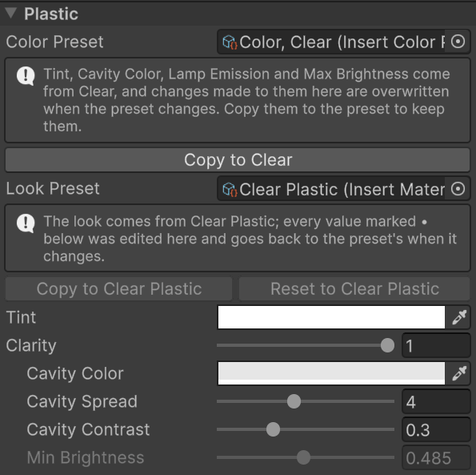

Start with every lamp off. Choose how dark the colored body should be, or how much of a bright cavity should show through clear plastic, before setting the lit brightness.

- *Color Preset* is the [color preset](presets.md#color) the material follows, which owns *Tint*, *Cavity Color*, *Lamp Emission*, and *Max Brightness*. *Copy to* puts this material's values into the preset.
- *Look Preset* is the [look preset](presets.md#look) the material follows, which owns everything else on this page. Values edited here are marked with a •. *Copy to* makes them part of the look; *Reset to* takes the look's values back. A material of the asset library, or of a locked library, is greyed out and can't be changed; its *Color Preset* row offers to edit it for the inserts wearing it, which gives them copies of their own. See [Changing a color](customizing.md#changing-a-color).

### Tint

*Tint* is the plastic's color. It multiplies the whole unlit body, tinted or clear, and nothing of the lamp: the lit color comes from *Lamp Emission* and the Insert Light component.

| White (Clear) | Red | Blue |
| --- | --- | --- |
|  | 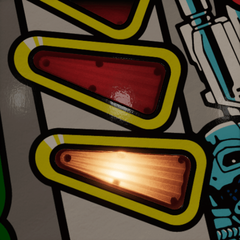 | 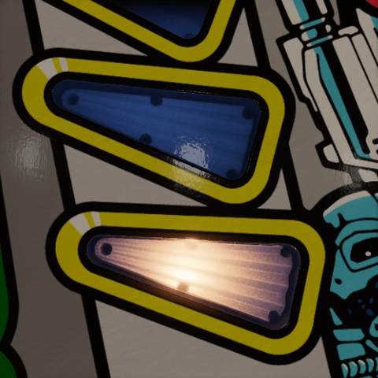 |

### Clarity

*Clarity* blends from tinted plastic at zero, dark until the lamp comes up, to clear plastic at one, which shows the lamp board or reflector under it lit by room light, lamp or no lamp.

| 0 | 0.5 | 1 (Clear Plastic) |
| --- | --- | --- |
| 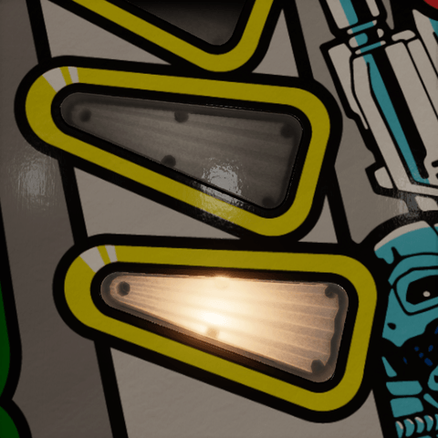 |  |  |

### Cavity Color

*Cavity Color* is what lies under a clear insert: the lamp board or reflector, still multiplied by *Tint*. A light gray suits a white board. Available when *Clarity* is above zero.

| Dark gray | Light gray (Clear) | Yellowed |
| --- | --- | --- |
| 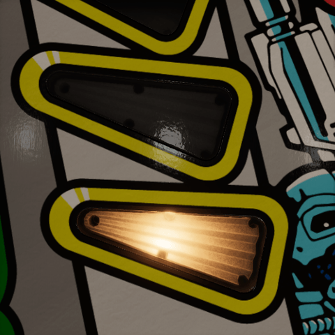 |  | 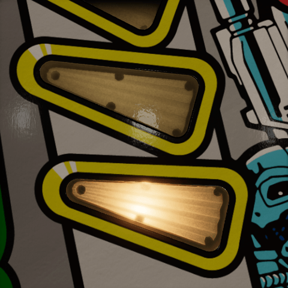 |

*Cavity Spread* is how far the cavity stays bright around the virtual lamp, in lamp radii, from 1 to 8. Wide keeps a clear starburst's ribs even; narrow darkens the faces that look past the lamp. *Cavity Contrast* is how much darker such a face gets, from 0 to 1. Keep it low for the soft ribs of real clear plastic. Both only show on a clear starburst, and so subtly on these inserts that they have no pictures.

### Min Brightness

*Min Brightness* is how much of the tint shows under room light with the lamp off, from 0 to 1. Low keeps a red insert dark until it is lit; it fades to full as the lamp comes up. Only the tinted share of the body uses it, and it does not keep the lamp's emission or spill on.

| 0 | 0.485 (Colored Plastic) | 1 |
| --- | --- | --- |
| 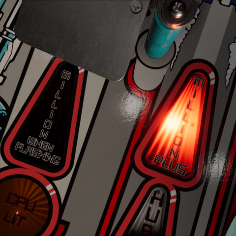 | 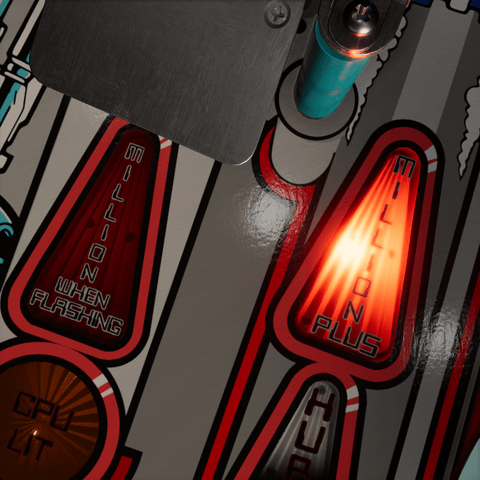 | 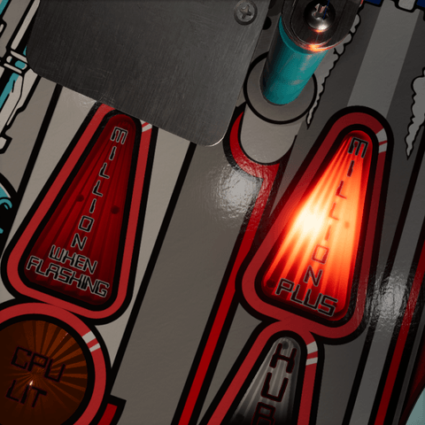 |

> [!NOTE]
> **Clear is an appearance, not transparency.** The hybrid body is opaque. Its clear look approximates the ambient-lit board or reflector viewed through plastic, using the baked response and virtual lamp positions. It does not sample a real object behind the insert or the screen color. The optional cover supplies the transparent top layer.

## Surface

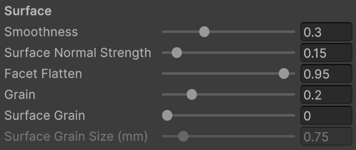

These settings shape how the body reflects the table's lights and probes. With a clear cover on the insert, the cover carries the glossy top, so the body's own reflections are faint; look for the highlight on the unlit insert.

### Smoothness

*Smoothness* is how sharp those reflections are, from 0 to 1. A high value is glossy; a low value spreads the highlights out until they disappear.

| 0 | 0.3 (Clear Plastic) | 1 |
| --- | --- | --- |
|  |  |  |

### Surface Normal Strength

*Surface Normal Strength* is how much of the baked surface normal map shapes the reflections, from 0 to 2: rounded edges, bevels, and baked grain. Keep it low; a starburst's facets are in the mesh already. Needs a surface normal map and *Facet Flatten* below one.

| 0 | 0.15 (Clear Plastic) | 2 |
| --- | --- | --- |
|  |  |  |

### Facet Flatten

*Facet Flatten* turns the normal the lights and probes see toward the insert's flat top, from 0 to 1. Zero keeps the facets, which suits colored inserts; around 0.85 stops a clear insert from alternating bright and dark ribs under a key light. The lamp's optics are not affected, and at one the baked surface relief is flattened too.

| 0 | 0.5 | 0.95 (Clear Plastic) |
| --- | --- | --- |
| 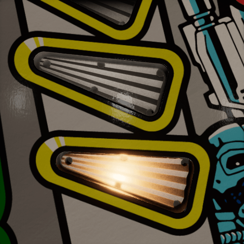 |  |  |

### Surface Grain

*Surface Grain* is the fine texture of the molded plastic in its reflections, from 0 to 1, drawn in insert space instead of baked into the normal map, so it stays sharp at any zoom. Keep the bake's *Grain Strength* at zero with it. It fades out where its cells fall below a pixel. *Variation Seed* picks another pattern.

| 0 (Clear Plastic) | 0.5 | 1 |
| --- | --- | --- |
|  |  |  |

*Surface Grain Size (mm)* is the size of the grain's cells, from 0.1 to 5 mm. The bake's grain measured 1.5 VPX units, about 0.75 mm. Shown with *Surface Grain* at 1.

| 0.1 mm | 0.75 mm (Clear Plastic) | 5 mm |
| --- | --- | --- |
|  |  |  |

### Grain

*Grain* is fine noise over the plastic's color and emission, lit and unlit, fixed in insert space, from 0 to 1. Zero is a smooth finish. It does not add roughness to the reflections. *Variation Seed* picks another pattern.

| 0 | 0.2 (Clear Plastic) | 1 |
| --- | --- | --- |
|  |  |  |

For a starburst, begin with a modest *Surface Normal Strength* because the mesh already has tilted facets. Stipples and engraving have a plain displayed floor and rely on their surface map for reflection relief. Setting *Facet Flatten* to one also suppresses that mapped relief in the reflection normal.

> [!NOTE]
> We bake two normal maps. *Surface Normal* is tangent-space data used by lights and probes. *Optical Normals* store sharp directions in insert-local space for the virtual bulb. *Surface Normal Strength* and *Facet Flatten* do not change optical direction. Baked grain affects the first map only.

## Lamp output

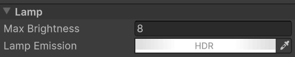

*Max Brightness* is shared by the material; each lamp's *Intensity* on the Insert Light component is a per-insert drive from 0 to 1. Raising the material's brightness therefore changes the maximum output of every insert using it.

### Max Brightness

*Max Brightness* multiplies the emission and the Insert Light component's spill at full intensity. Zero turns both off. It is a number field on purpose: 10, 20, or 50 are reasonable values to try, depending on the scene's exposure.

| 2 | 8 (Clear) | 32 |
| --- | --- | --- |
|  |  | 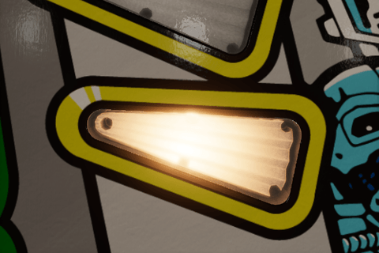 |

### Lamp Emission

*Lamp Emission* is the nominal radiance of the lit insert, an HDR color that multiplies every lamp's *Color*. Keep it neutral: a neutral emission lets the Insert Light component and RGB lamps supply the hue, and a colored one filters it. Its hue also colors the spill.

| A quarter | Neutral (Clear) | Warm |
| --- | --- | --- |
| 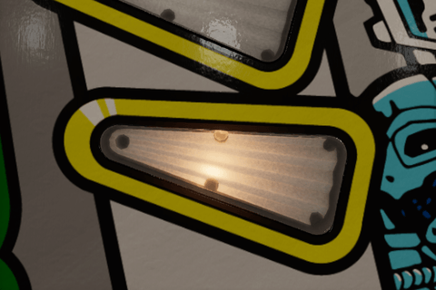 |  | 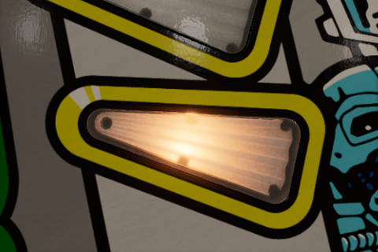 |

> [!TIP]
> Keep the camera exposure fixed while tuning or comparing brightness. Auto-exposure can hide an increase by darkening the rest of the table. These emission values are artistic radiance controls, rather than a calibrated conversion from physical bulb wattage.

## Virtual lamp

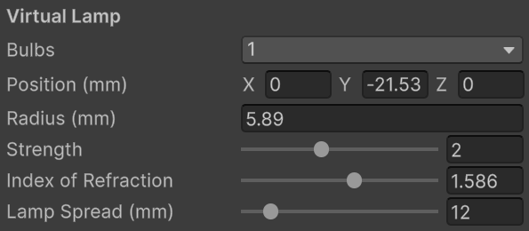

The virtual lamp is an image of the bulb seen through the plastic's facets.

- *Bulbs* is the active bulb count, the same setting as *Number of lamps* on the Insert Light component.
- *Position (mm)* is the first lamp's insert-local position; additional bulbs get a row each. See [Position](lighting.md#position) on the Lighting page for what it does.

Using the hybrid material starts the first lamp from the bake's suggestion: its radius is 40% of the insert's local X extent, with a minimum of 1 mm, and its center is below the lowest point by the larger of 1.5 times that radius or 5 mm. Tune both afterward.

### Radius

*Radius (mm)* is the size of the soft bulb image, shared by all active bulbs. A larger radius broadens the moving hotspot and also widens the cavity that *Cavity Spread* measures.

| 2 mm | 5.89 mm (this material) | 12 mm |
| --- | --- | --- |
| 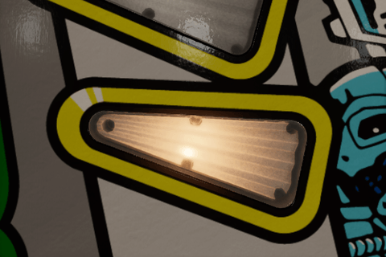 | 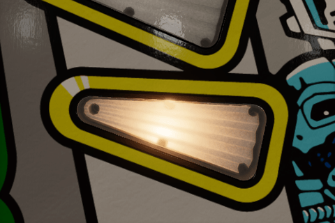 | 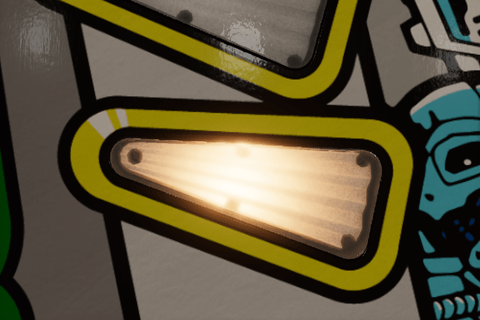 |

### Strength

*Strength* is how much of the lit look is the lamp seen through the facets, against the baked glow, from 0 to 5. Zero leaves only the glow.

| 0 | 2 (Clear Plastic) | 5 |
| --- | --- | --- |
| 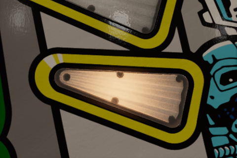 |  |  |

### Index of Refraction

*Index of Refraction* is how strongly the facets bend the view toward the lamp, from 1.01 to 2. Acrylic is about 1.49. A clear insert's cavity view bends the same way. The bend shows when the insert is seen at an angle, so these pictures look at the lit insert from the side.

| 1.01 | 1.586 (Clear Plastic) | 2 |
| --- | --- | --- |
| 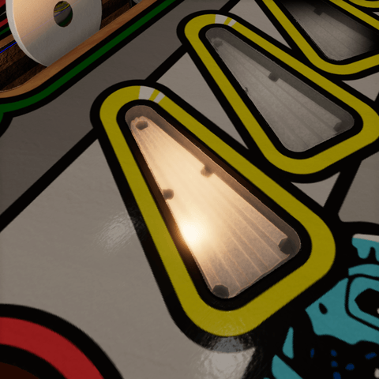 | 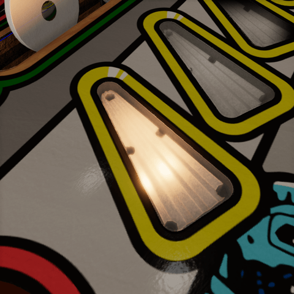 | 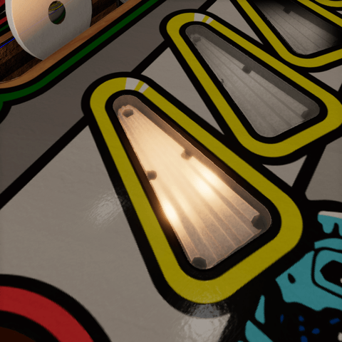 |

### Lamp Spread

*Lamp Spread (mm)* is how far from each bulb the lit look reaches before it has fallen to half, from 0 to 100 mm. At twice that distance it is a fifth, at three times a tenth: a real insert is brightest around its bulb, and a banana's bulbs meet in a soft blend. Zero lights the whole body alike, which floods it as *Max Brightness* goes up. The Insert Light component's *Tint With Lamp* reaches as far.

| 4 mm | 12 mm (Clear Plastic) | 100 mm |
| --- | --- | --- |
|  | 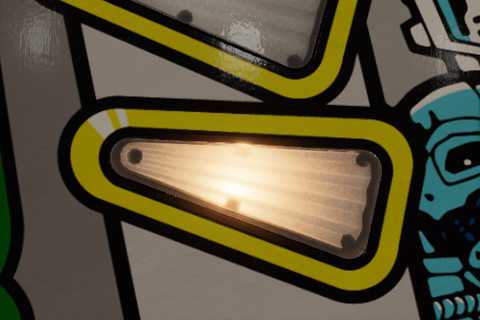 | 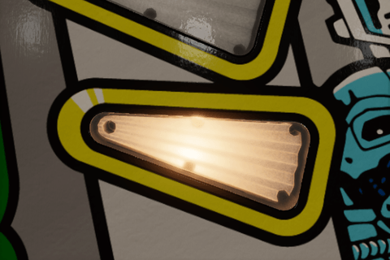 |

> [!NOTE]
> **Refraction and parallax.** The shader refracts the view ray through a flat entrance and the patterned surface, then evaluates a virtual bulb below the insert. Its image shifts with the viewpoint and is evaluated independently for each eye. No screen texture is needed. The source geometry and neutral optical maps stay fixed while position, radius, and refraction are tuned live.

## Glow

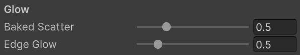

The glow is light the bake found inside the plastic. It supplements the virtual bulb's image and stays when its *Strength* is zero. Both need *Max Brightness* above zero and a lit lamp.

### Baked Scatter

*Baked Scatter* is broad light scattered through the plastic, from the bake's cavity response, from 0 to 2. Too much washes out the starburst.

| 0 | 0.5 (Clear Plastic) | 2 |
| --- | --- | --- |
| 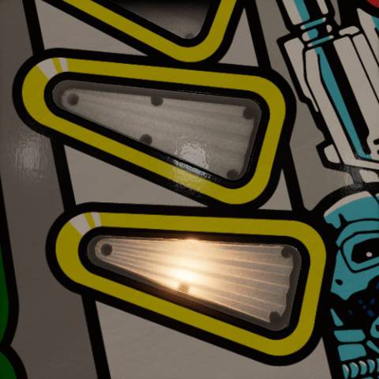 |  | 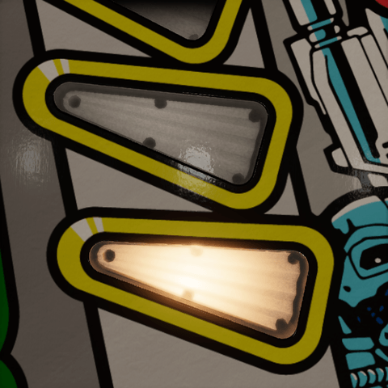 |

### Edge Glow

*Edge Glow* is light caught by rounded edges, rims, and hole walls, from the bake's edge response, from 0 to 3. Keep it low, or every edge turns into a neon outline.

| 0 | 0.5 (Clear Plastic) | 3 |
| --- | --- | --- |
| 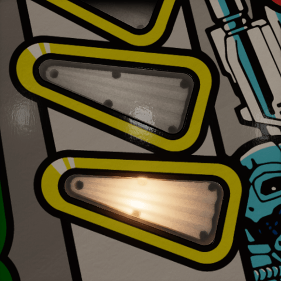 | 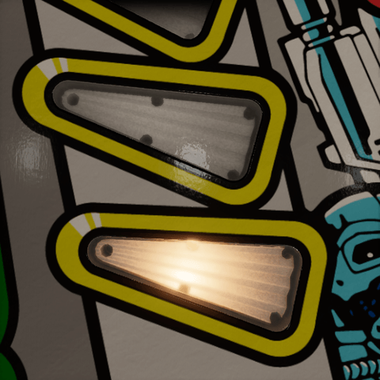 |  |

## Facets

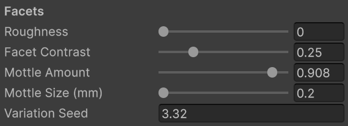

These settings use the baked starburst sectors to align variation with the fan. They are disabled when there is no starburst, and need a visible lamp or scatter.

### Roughness

*Roughness* is how rough the structure inside the plastic is: the facets, channels, and holes the light comes up through, from 0 to 1. Zero couples the lamp into crisp ribs and rays; one diffuses it, so the ribs soften and the rays and the bulb's image go into the glow. The finish of the top is the cover's.

| 0 (Clear Plastic) | 0.5 | 1 |
| --- | --- | --- |
|  | 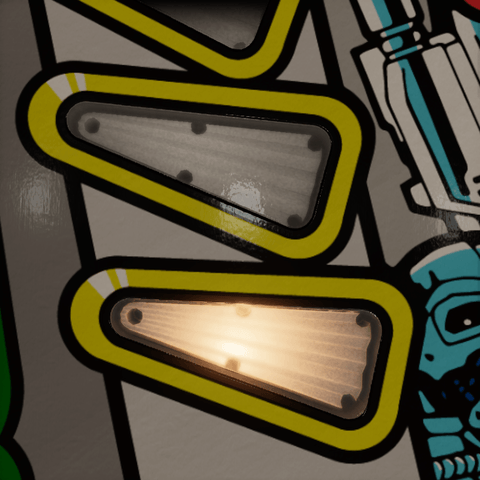 | 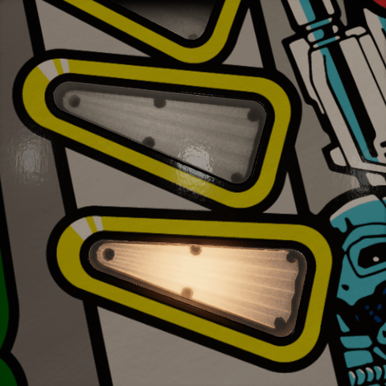 |

### Facet Contrast

*Facet Contrast* is how differently the two slopes of each rib take the lamp's light, from 0 to 1. One gives crisp alternating ribs; about a quarter suits clear plastic.

| 0 | 0.25 (Clear Plastic) | 1 |
| --- | --- | --- |
|  |  |  |

### Mottle

*Mottle Amount* is cloudy variation across the ribs, and small differences from rib to rib, from 0 to 1.

| 0 | 0.45 | 0.908 (Clear Plastic) |
| --- | --- | --- |
|  |  |  |

*Mottle Size (mm)* is the spacing of the mottle's cells, from 0.2 to 5 mm. Smaller is finer; it fades out once the cells are smaller than a pixel. Enabled when *Mottle Amount* is above zero.

| 0.2 mm (Clear Plastic) | 1 mm | 5 mm |
| --- | --- | --- |
|  |  |  |

### Variation Seed

*Variation Seed* picks another pattern for the mottle, the rib-to-rib differences, and the grain. It is not a brightness setting, and stays useful without a starburst when *Grain* is above zero.

| 3.32 (Clear Plastic) | 7 | 23 |
| --- | --- | --- |
|  |  |  |

## Baked Data

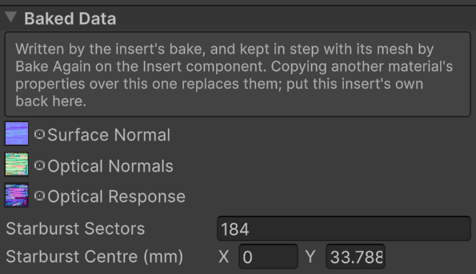

*Bake Again* owns these values and keeps them aligned with the body mesh. They are exposed to recover an insert's own maps after accidental material copying, or for a deliberately authored custom material. Copying another insert's maps can break the alignment even if the outlines look similar.

- *Surface Normal* is the tangent-space normal texture used for surface reflections.
- *Optical Normals* is the texture of sharp directions in insert-local space.
- *Optical Response* holds the cavity, edge, and transmission data described on [Baking](baking.md#output).
- *Starburst Sectors* is the sector count, normally twice the generator's *Bursts*. Below four the starburst-specific variation is inactive.
- *Starburst Centre (mm)* is the fan's X/Z center in insert-local millimeters. It must match the generated starburst center.

Do not retile these maps independently. The body's final UVs, tangents, and all three maps belong to one bake. Generated lamp suggestions also start from that insert's dimensions; they are then free to be tuned as material settings.

> [!NOTE]
> **Shader properties.** The controls use `_BaseColor` (*Tint*), `_InsertClarity`, `_InsertCavityColor`, `_InsertCavitySpread`, `_InsertCavityContrast`, `_InsertMinBrightness`, `_Smoothness`, `_NormalStrength`, `_InsertFacetFlatten`, `_OpticalGrain`, `_SurfaceGrain`, `_SurfaceGrainSize`, `_InsertLuminosity`, `_EmissiveColor`, `_OpticalLampGain`, `_OpticalIor`, `_OpticalSpread`, `_OpticalScatter`, `_OpticalEdgeGlow`, `_OpticalContrast`, `_OpticalVariation`, `_OpticalMottleSize`, `_OpticalSeed` and `_InsertRoughness`. The names matter when editing look preset entries; the inspector shows the labels.

> [!NOTE]
> **Generated and runtime properties.** `_NormalMap`, `_OpticalNormalMap`, and `_OpticalResponseMap` hold the textures. `_OpticalLamp`, `_OpticalLampB`, `_OpticalLampC`, and `_OpticalLampD` store local XYZ and radius W in meters; an additional bulb with radius zero is inactive. `_OpticalStarburst` stores center X/Z in X/Y, sector count in Z, and lowest fan height in W, with positions in meters. The Insert Light component supplies `_InsertLampLevel` and linear `_InsertLampColor` for the first lamp, `_InsertLampColorB/C/D` as linear RGB plus intensity in W for the other lamps, and `_InsertLampTint` for the tint blend. Edit those runtime values through the Insert Light component rather than through the material asset.

## HDRP surface options

The material retains HDRP's standard *Surface Options* and *Advanced Options*. The supplied body uses an opaque surface, while the separate cover uses transparency. The custom *Smoothness* and surface normal controls shape the body's standard HDRP lighting and reflections; lamp emission is added alongside them. General table lighting, reflection probes, exposure, and post-processing still affect the final appearance.
