# Insert Cover

The body supplies the molded interior and its optical appearance. A **clear cover** closes the opening at the rim with a flat top, adding its own reflections, haze, and surface detail. It is optional and independent of the body bake, so you can add or tune it without baking again.

The Cover shader supports HDRP and URP with the same material and runtime lamp controls. URP renders reflections, haze, lamp tint, and playfield-normal detail with specular highlights preserved over the transparent surface. For slab refraction and transmission tint, enable **Opaque Texture** and **Depth Texture** on the URP asset or camera, set the renderer's **Depth Texture Mode** to **After Opaques** or **Force Prepass**, and use **None** for opaque-texture downsampling to retain the baked detail. The shader bends the opaque background through the slab and attenuates it by the plastic's tint and thickness. It cannot refract transparent objects or objects outside the camera view. A camera without both buffers before transparent rendering, or an overlay camera, renders the cover's haze and reflections over the body without slab refraction.

The pictures show two clear inserts sharing one cover material, changing one value at a time: the upper insert is off, the lower one is lit. The middle picture is the value the clear cover has today.

## Adding a cover

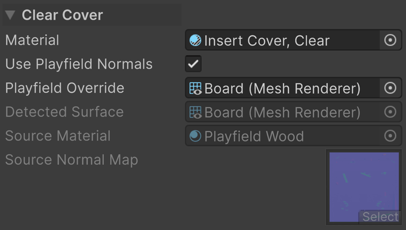

In the *Clear Cover* section of the Insert component, assign *Material* or click *Add Clear Cover*. The helper creates a *Pinball/Insert Cover* material with a subtle haze and glossy finish. Clearing *Material* removes the top surface.

- *Material* is the material of the generated top surface, in the renderer's second material slot. Any material can be assigned, but the dedicated cover shader supplies the plastic, haze, lamp tint, and playfield-normal features described here.
- *Use Playfield Normals* projects the detected playfield's normal detail across the cover. Available for the dedicated Insert Cover material. Off, the cover uses its material's own map and local UVs.
- *Playfield Override* is an optional Mesh Renderer component supplying the normal map and UV projection. Leave it empty for automatic playfield detection.
- *Detected Surface*, *Source Material*, and *Source Normal Map* show the renderer the projection comes from, its first material, and that material's normal map.

| No cover | Clear cover |
| --- | --- |
| 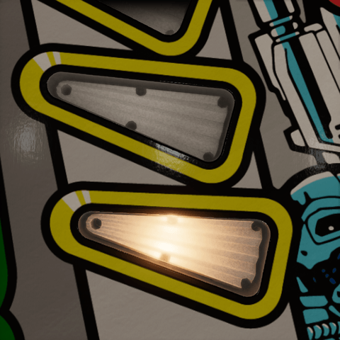 | 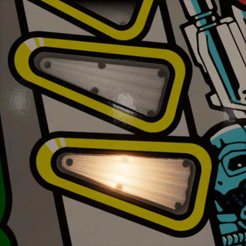 |

> [!NOTE]
> **Separate material slot.** The cover is added after the body's bake has been applied. Its triangles, UVs, and per-slot material overrides do not change the body's bake hash or atlas. A custom cover material determines its own transparency and shadows; the dedicated cover keeps reflections visible at low opacity and does not cast a solid shadow.

## Plastic

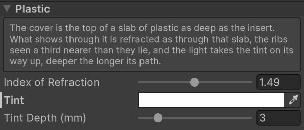

The cover is the top of a slab of plastic as deep as the insert. What shows through it is refracted as through that slab, and the light takes the plastic's tint on its way up, the more the longer its path.

### Index of Refraction

*Index of Refraction* is how much the plastic bends the view, from 1 to 2: 1.49 for acrylic, 1.59 for polycarbonate. One is no slab at all. A higher index shows the ribs nearer than they lie. The shift shows at a low angle, so these pictures look along the inserts from behind: watch the near insert's floor and holes against its frame. The refraction is a screen-space effect, and at grazing views it can slide a band of the ribs across the insert, so the shipped clear cover leaves it at one and keeps only its glossy top and its haze.

| 1 | 1.49 | 2 |
| --- | --- | --- |
| 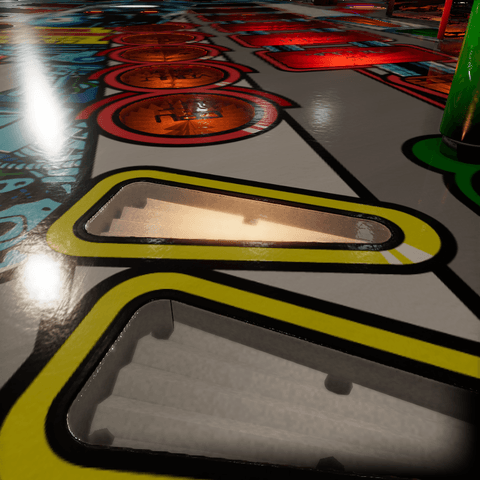 |  | 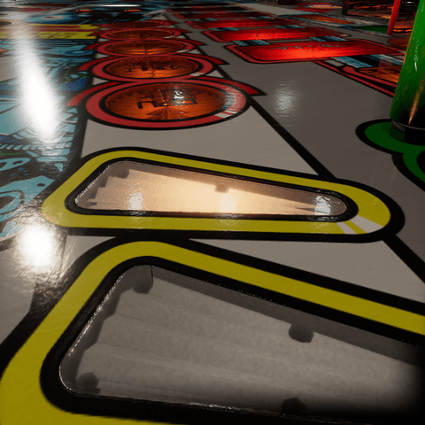 |

### Tint

*Tint* is the color the light has once it has come *Tint Depth* through the plastic. White suits clear plastic; a colored insert takes its color, and then darkens toward its edges and at grazing views, as tinted plastic does. The light takes the tint on its way through the slab, which only exists while *Index of Refraction* is above 1: at 1, *Tint* and *Tint Depth* do nothing. The shipped clear cover is at 1 and stays untinted; the colored covers are at 1.49. These pictures are at 1.49.

| White (Clear) | Red | Blue |
| --- | --- | --- |
|  |  | 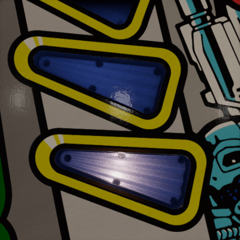 |

### Tint Depth

*Tint Depth (mm)* is how far through the plastic the light goes to take the tint, from 0.1 to 20 mm. Shorter is a denser plastic. Shown with the red tint.

| 0.1 mm | 3 mm | 20 mm |
| --- | --- | --- |
| 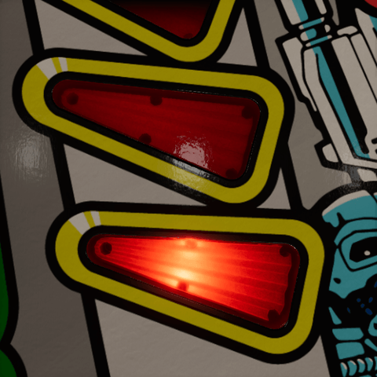 | 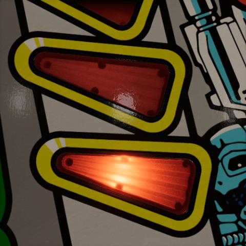 |  |

## Haze

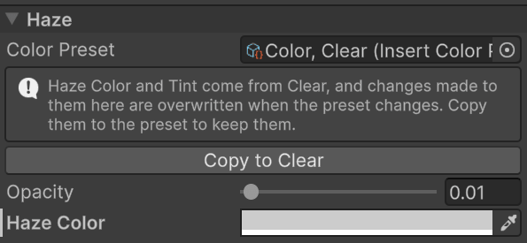

The haze is the veil seen over the interior. It can be nearly invisible, lightly worn, or milky. *Color Preset* is the [color preset](presets.md#color) the cover follows, which owns the *Haze Color* and the plastic's *Tint*. While the material is linked, those fields are grayed out: change them in the color preset with *Manage*, or set *Color Preset* to none to change them in this material alone. A material of the asset library, or of a locked library, is grayed out and can't be changed: fork the insert wearing it first, which gives it copies of its own. See [Forking an insert](basics.md#forking-an-insert).

With *Tint With Lamp* enabled on the Insert Light component, the haze takes the local lamp hue while keeping its brightness. Without that tint, a gray veil can make a saturated lamp look pale. See [Lighting](lighting.md#tint-with-lamp).

### Opacity

*Opacity* is how much of the haze shows over the body, from 0 to 0.5. A hundredth is a clean top with only its reflection; 0.05 to 0.1 is a veil that softens the ribs like worn or slightly frosted plastic. The reflections stay at full strength whatever the value.

| 0.01 (Clear) | 0.1 | 0.5 |
| --- | --- | --- |
|  | 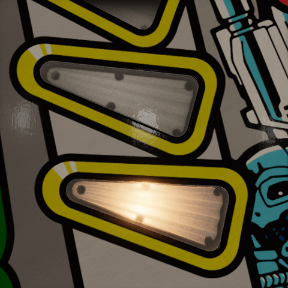 | 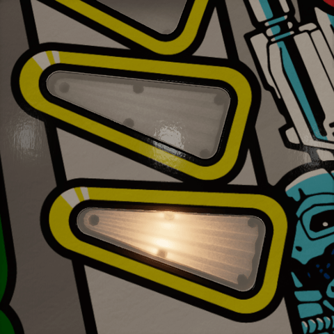 |

### Haze Color

*Haze Color* is the color of that veil. A light gray suits worn clear plastic; darker grays dull the body, white brightens it, and a colored haze filters it. Disabled at zero *Opacity*. Shown at *Opacity* 0.3, where the color reads.

| Light gray (Clear) | Blue | Orange |
| --- | --- | --- |
| 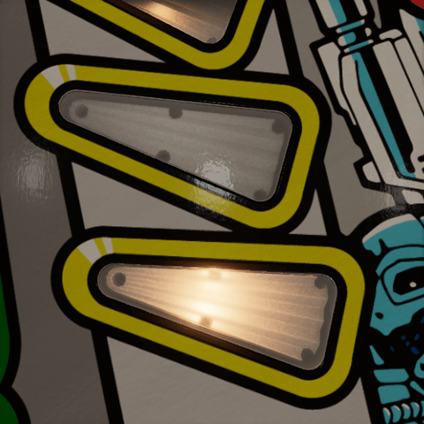 | 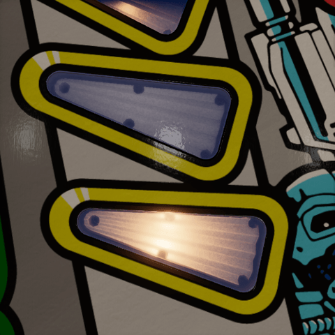 | 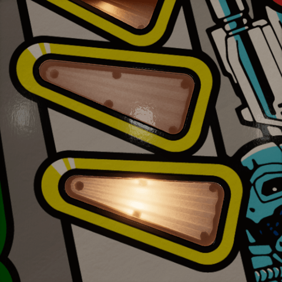 |

## Surface

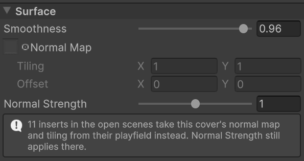

- *Normal Map* holds scratches or fine texture for the top. Without playfield projection it uses local 0–1 UVs spanning the top. *Tiling* and *Offset* repeat and shift it; they are disabled when no map is assigned.
- *Normal Strength* scales the detail, from 0 to 2. Zero is flat. With playfield projection, it multiplies the source material's normal strength; one matches the source. The playfield on these pictures has too little normal detail over the inserts to show a difference, so this one has no pictures.

The cover's material Inspector reports when inserts in the open scene use playfield normals instead of its own map. In that case the source supplies the effective texture and projection; the cover's *Smoothness* and *Normal Strength* still apply.

### Smoothness

*Smoothness* is how sharp the lights and probes reflected in the top are, from 0 to 1. Match the surrounding playfield for a highlight that continues across the insert. A rough top turns matte and veils the body under its own diffuse reflection; at zero it hides it entirely.

| 0.5 | 0.75 | 0.96 (Clear) |
| --- | --- | --- |
|  | 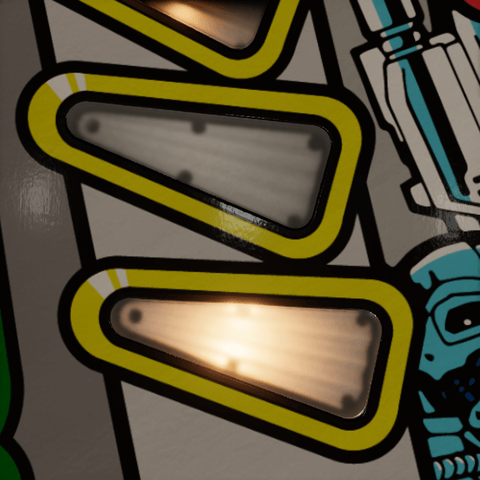 | 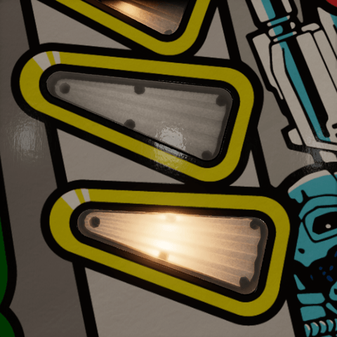 |

## Playfield normals

Enable *Use Playfield Normals* when scratches, wood grain, or other top-surface normal detail should continue across the insert boundary. VPE detects a surface under the enclosing Playfield component, or under the single Playfield component in the same Table component, and can choose the largest suitable imported surface. Use *Playfield Override* when the intended surface is not the detected one. Like *Normal Strength*, it only shows where the playfield's normal map has detail over the insert, which is not the case on these pictures.

The source must have a readable mesh with a planar top and usable UV0 in its first submesh. Enable *Read/Write* on an imported mesh if needed. Its first material needs a supported normal map; the projection supports HDRP Lit tangent-space normal maps and follows the source base-map tiling, offset, and normal strength.

> [!NOTE]
> **Projection.** VPE derives the source mesh's actual XZ-to-UV mapping, including rotations, flips, and margins. The cover receives matching UVs and tangent frames, while a per-renderer override supplies the source normal texture and strength. Neither shared material is rewritten. Moving either object updates the projection in the authoring scene.

<!-- Diagram: cover-projection. One scratch crossing playfield and cover, with the source UV transform and cover's matching projection highlighted. -->

The source texture needs detail over the insert area for anything to appear there. Matching normal detail does not also match smoothness: tune the cover's *Smoothness* to the playfield's effective mask-map smoothness for a continuous highlight.

Disabling projection restores the local cover UVs and its own material settings. If detection or the source becomes invalid, the Inspector reports the problem and falls back to those material settings. Check *Detected Surface*, *Source Material*, and *Source Normal Map* before trying to compensate with cover tiling.

## Shader properties

> [!NOTE]
> The authored cover properties are `_CoverIor`, `_CoverTint`, `_CoverTintDepth`, `_CoverOpacity`, `_HazeColor`, `_Smoothness`, `_CoverNormalMap` (including its texture tiling and offset), and `_CoverNormalStrength`. `_CoverThickness` is supplied by the component from the insert's depth, and `_PlayfieldNormalStrength` for a detected source; it defaults to one for a local map. The Insert Light component also supplies `_InsertLampLevel`, `_InsertLampColor`, `_InsertLampTint`, `_OpticalLamp/B/C/D`, `_InsertLampColorB/C/D`, and `_OpticalSpread` to this material slot. Their encodings match the [body's runtime data](body-material.md#baked-data). They let the haze follow the same spatial lamp mix; the cover itself emits no lamp light.
