# Insert Geometry

The geometry of an insert is based on a two-dimensional shape. This shape is then extruded downwards, where it optionally gets inset for an additional channel which is then extruded upwards. To that bottom surface, a [patterns](patterns.md) can be additionally applied. On top sits the cover, which becomes part of the playfield.

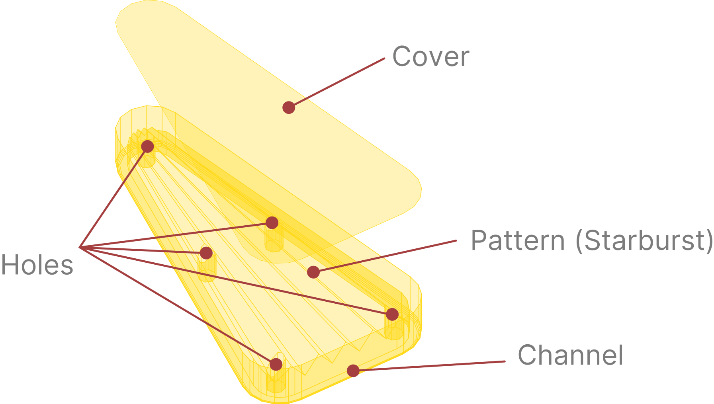

This setup is procedurally generated, so every parameter can be tweaked directly in the editor and the result is instantly visible. In this section we'll walk you through the common configuration and specifics of each shape that VPE currently supports.

## Dimensions and coordinates

Length fields in the mesh generator use **VPX units**, even where the Inspector simply says *Width* or *Depth*. One unit is 0.53975 mm; an inch is about 47.059 units. The preview also reports the finished width and height in inches. See [Units and 3D Space](../units-3d-space.md).

> [!NOTE]
> Controls unique to a shape remain stored when you switch. *Width* and *Height* are shared by Triangle, Rectangle, Diamond, Bullet, and Arrow.

## Rounded corners and sampling

Every corner group has the same two controls:

- *Radius* is the radius of the rounded corner. Zero gives a sharp corner. A larger radius consumes more of the straight sides on either side. VPE reduces it if it cannot fit and shows a warning.
- *Segments* is the number of straight segments approximating that arc, from 1 to 64. One gives a chamfer; more make it rounder. Each arc has one more vertex than segments.

*Radius* changes the shape. *Segments* changes how closely the mesh follows that shape. A higher segment count also adds walls and bake work, so use the lowest count that looks smooth from the intended camera.

<!-- Screenshot: geometry-corners. Radius 0 versus 4; separately Segments 1 versus 8. Outline overlay and oblique wireframe. Repeat for the groups listed in visuals.md. -->

## Triangle

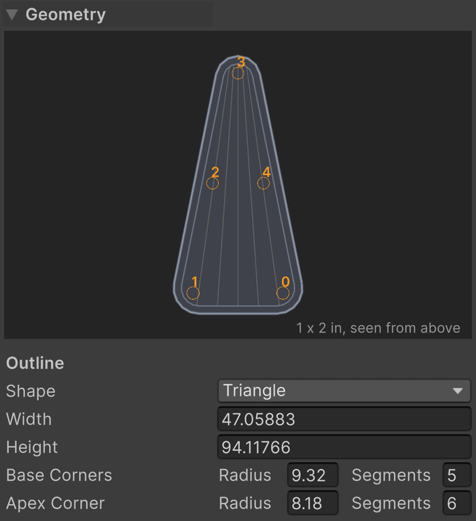

- *Width* is the finished width across the base.
- *Height* is the finished distance from the base to the apex.
- *Base Corners* sets the radius and segments shared by the two ends of the base.
- *Apex Corner* sets the radius and segments of the opposing tip.

Base and apex rounding can be tuned independently. The generator adjusts the underlying triangle so the requested finished dimensions are retained.

<!-- Screenshot: geometry-triangle. Top view; vary Width, Height, and each corner group individually. -->

## Rectangle

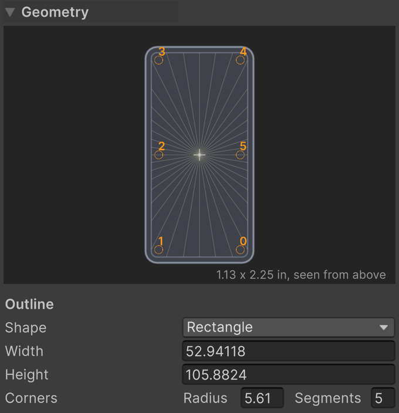

- *Width* is the finished horizontal extent.
- *Height* is the finished vertical extent in the outline preview.
- *Corners* sets the radius and segments shared by all four corners.

<!-- Screenshot: geometry-rectangle. Square and elongated rectangle; individual width, height, and rounding comparisons. -->

## Circle

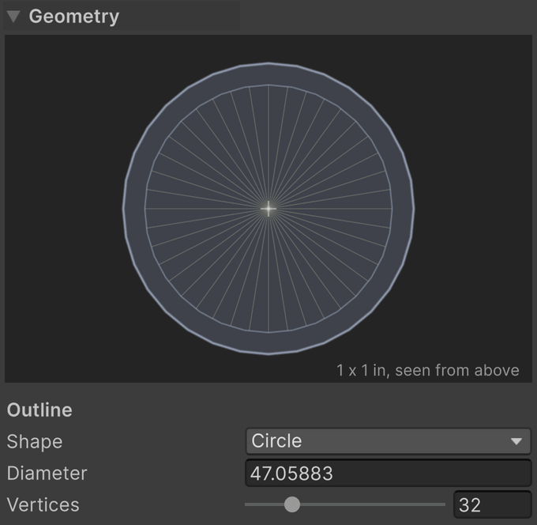

- *Diameter* is the diameter of the circular outline.
- *Vertices* is the number of sides approximating the circle, from 6 to 128.

A circle has no separate corner controls. *Vertices* determines its entire outline sampling.

<!-- Screenshot: geometry-circle. Diameter 47.059 versus 70.588; Vertices 8 versus 32 with wireframe. -->

## Banana

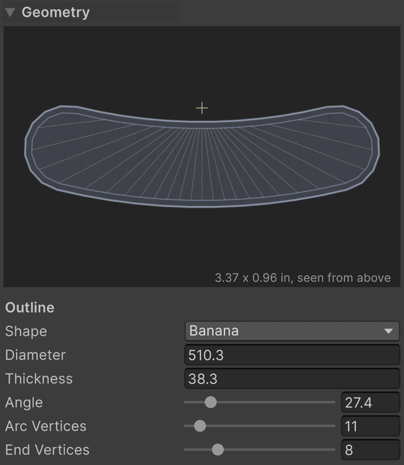

The banana is a band bent around a circle, with rounded ends. Its *Diameter* describes the circle through the middle of the band, rather than the band's outer diameter.

- *Diameter* is the diameter of the circle followed by the band's centerline.
- *Thickness* is the width across the band. Half extends on either side of that centerline.
- *Angle* is the sweep around the circle, from 1° to 180°. The ends turn upward in the preview.
- *Arc Vertices* is the segment count along each of the two arcs, from 2 to 128.
- *End Vertices* is the segment count around each rounded end, from 2 to 32.

*Thickness* limits how wide its channel can be. A starburst centered on the banana's arc can create ribs crossing the band evenly; see [Starburst](patterns.md#starburst).

<!-- Diagram: geometry-banana-measures. Centerline diameter, band thickness, angle, and arc center labeled. -->

## Diamond

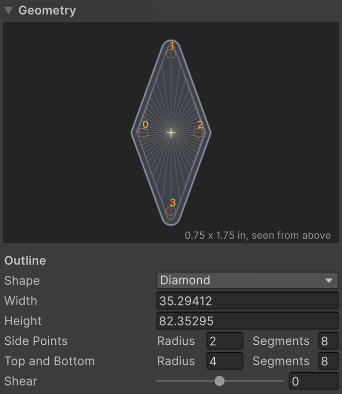

- *Width* is the finished extent across the side points.
- *Height* is the finished extent between the top and bottom.
- *Side Points* sets the radius and segments shared by the left and right points.
- *Top and Bottom* sets the radius and segments shared by the upper and lower points.
- *Shear* leans the top and bottom points away from upright, from −75° to 75°. Positive leans toward the table's right in the preview. Zero is upright.

<!-- Screenshot: geometry-diamond. Shear 0 versus 25, plus separate corner comparisons. -->

## Flash

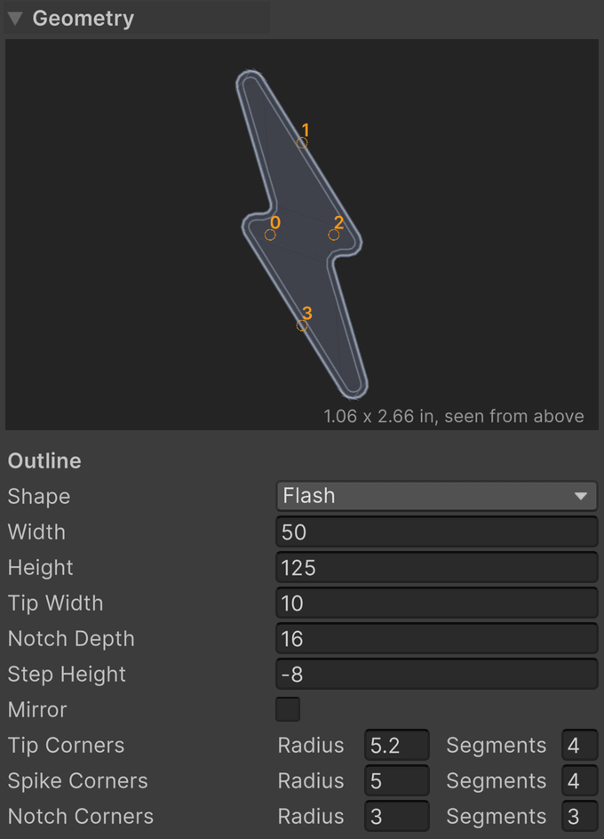

The flash has two offset arms, flat ends, projecting spikes, and inward notches. These controls let you fit a lightning-bolt insert without drawing its polygon manually.

- *Width* is the finished extent from spike to spike.
- *Height* is the finished extent from end to end.
- *Tip Width* is the width of each flat end.
- *Notch Depth* is the distance inward from a spike to its notch. It must be less than half the width.
- *Step Height* places the two steps above and below the middle. Zero aligns them with the middle line. Negative values increase the overlap of the arms.
- *Mirror* flips the flash left to right, so the bolt runs the other way.
- *Tip Corners* sets the radius and segments for the four corners of the flat ends.
- *Spike Corners* sets the radius and segments for the two projecting spikes.
- *Notch Corners* sets the radius and segments for the two inward turns. These fillets round inward.

The [Engraved Line](patterns.md#engraved-line) is a pattern on the flash's floor. Its inset is measured from the floor edge, and does not change these outline controls.

<!-- Diagram: geometry-flash-measures. Tip Width, Notch Depth, Step Height, and all three corner groups labeled. -->

## Bullet

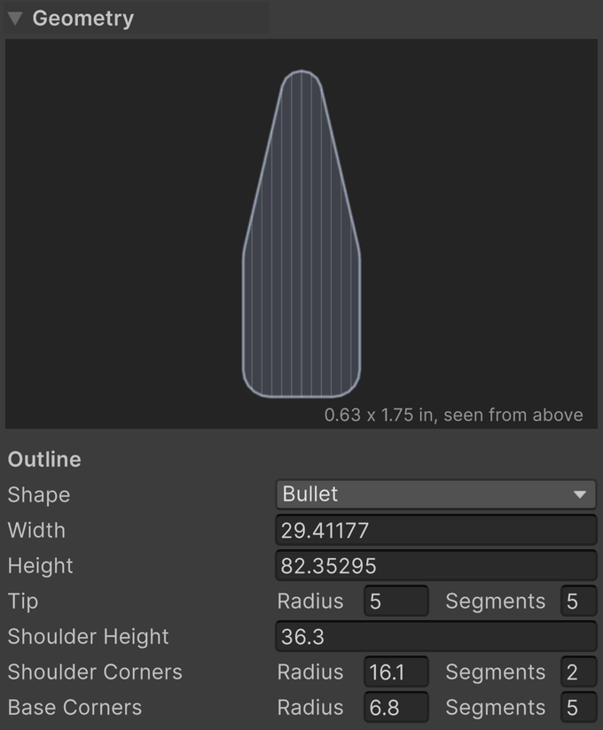

- *Width* is the finished width of the bullet.
- *Height* is the finished height from base to tip.
- *Tip* sets the radius of a circular tip touching the top, and the segments across the whole tip arc. A radius of zero makes the tip pointed. The radius is limited to fit inside the bullet's width and height, and the segment count is rounded up to an even number.
- *Shoulder Height* is the height from the base at which the straight sides turn toward the tip. Zero starts the sloping flanks at the base. The shoulders remain below the tip's center.
- *Shoulder Corners* sets the radius and segments where the straight sides meet those flanks.
- *Base Corners* sets the radius and segments at the two base corners.

<!-- Diagram: geometry-bullet-measures. Circular tip radius and shoulder height labeled; show pointed and rounded tip. -->

## Arrow

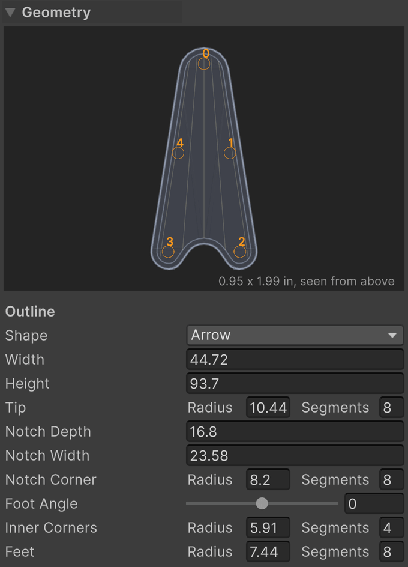

The arrow can have a flat base, a narrow notch with feet on either side, or a notch spanning the entire base for a chevron.

- *Width* is the finished width across the base.
- *Height* is the finished height from base to tip.
- *Tip* sets the radius and segments of the upper point.
- *Notch Depth* is how far the notch cuts into the base. Zero gives a flat base and disables the notch-specific controls.
- *Notch Width* is the width of the notch opening. At the full base width there are no feet, so *Foot Angle* and *Inner Corners* are disabled.
- *Notch Corner* sets the radius and segments at the inward notch apex. A large radius makes a round scoop.
- *Foot Angle* tilts the feet, from −85° to 85°. Positive lifts their inner corners; negative drops them below the outer corners.
- *Inner Corners* sets the radius and segments where each foot turns into the notch.
- *Feet* sets the radius and segments at the two outer base corners.

<!-- Diagram: geometry-arrow-measures. Flat base, notched arrow, and full-width chevron, with the four corner groups labeled. -->

## Custom

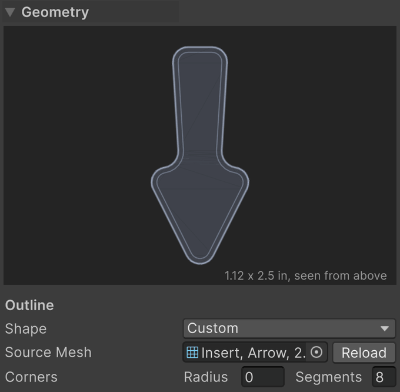

Choose *Custom* when a standard outline cannot match the playfield opening. Assign a mesh asset in *Source Mesh*, including a mesh subasset from an imported model. The source is separate from the generated insert: VPE reads its outline, then builds the body, channel, bevel, holes, and selected pattern using the same controls as the standard shapes.

- *Source Mesh* is a readable, flat mesh containing one closed wire boundary, or a filled surface with one outer boundary. Lines, an explicitly closed Line Strip, triangles, and quads are supported.
- *Reload* reads the source again after you change or reimport the mesh. Geometry edits also read it again. Rebake if the source geometry changed.
- *Corners* sets the rounding shared by the imported outline's corners. A radius of zero preserves the source outline. Straight boundary samples are merged before rounding.

The source's local dimensions are in Unity meters. VPE centers its bounding box and aligns its plane with the insert's XZ plane, retaining its size. A source already in XZ keeps its orientation; other planes are rotated flat. Position, rotation, and scale on the GameObject that originally used the mesh are not part of a mesh asset. Apply those transforms in your modeling tool when they should change the source's dimensions.

An invalid source shows an error in the Inspector and keeps the last mesh that worked. The bake button is disabled until the problem is corrected. Open boundaries, non-flat vertices, separate shapes, nested boundaries, branches, zero-length edges, and self-intersections are rejected. Add holes with the insert's *Holes* controls instead of placing another boundary in the source. Enable *Read/Write* in the model's import settings if requested.

<!-- Screenshot: geometry-custom. A closed wire and matching filled mesh producing the same insert; Source Mesh None/assigned, Corners Radius 0/2 and Segments 1/8. Show errors for an open, non-flat, and multiple-outline source. -->

> [!NOTE]
> **Source geometry and packaged geometry.** The custom source is authoring data. Its original vertex positions and edge/face indices are saved in the editor sidecar when exporting a `.vpe` and restored as a project mesh asset when importing for editing. The player receives the finished generated mesh in the GLB and never reads or regenerates the custom source. Imported UV/normal seams at identical positions are welded when checking the boundary; the source's UVs and shading normals do not drive the generated insert.

## Body, channel, and bottom bevel

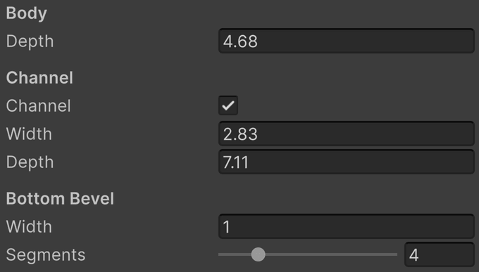

*Depth* sinks the main floor below the rim. A channel surrounds that floor and sits lower still, leaving the main floor as a raised middle. This distinction matters when placing holes and limiting pattern height.

- *Body → Depth* is the distance from the rim to the main floor. With a channel, the deepest floor is Body Depth plus Channel Depth.
- *Channel* enables the surrounding recessed channel. Without it, the main floor reaches the outside wall.
- *Channel → Width* is the distance inward from the outline to the raised middle. Zero gives no channel even when the toggle is enabled. It is reduced if the inset would fold or consume the shape.
- *Channel → Depth* is the additional distance below the main floor. The channel's width still matters when its depth is zero.
- *Bottom Bevel → Width* rounds the edge where the outer wall meets the channel floor, extending up the wall and inward along the floor. Zero leaves a sharp edge. It is limited to fit the wall and channel.
- *Bottom Bevel → Segments* is the number of segments approximating that rounding, from 1 to 16. One gives a flat chamfer.

*Bottom Bevel* is actual geometry and requires a channel. The separate *Edge Bevel* under *Normal Bake* rounds sharp edges in the surface normal map; it does not replace this body bevel.

<!-- Diagram: geometry-body-cutaway. Dimension Body Depth, Channel Width/Depth, and Bottom Bevel Width. Pair channel enabled/disabled and bevel 0/1. -->

## Holes

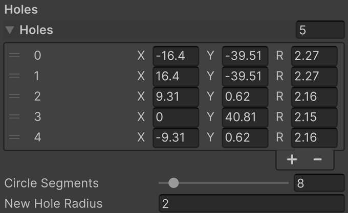

Holes cut through the raised middle to the channel floor. They require a channel with a nonzero width. They describe molded detail in the insert, rather than a new physical ball hole in the playfield.

- *Holes* is the editable list of holes. Each numbered row corresponds to the numbered hole in the preview and Scene view.
- *X, Y* is the hole's center relative to the insert's origin, in generator coordinates and VPX units.
- *R* is the radius of that hole. Each hole can have a different radius.
- *Circle Segments* is the side count for every hole, from 3 to 64.
- *New Hole Radius* is the radius assigned when adding a hole or using a placement preset. Changing it does not resize existing holes.

Drag the circular Scene handle to move a hole across the insert. Drag the small dot on its rim to change its radius. The Inspector's *X*, *Y*, and *R* fields provide exact placement and size.

<!-- Screenshot: geometry-holes. A numbered Inspector row and its Scene handle; compare center, radius, and circle sampling. -->

### Placement helpers

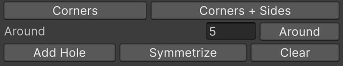

- *Corners* replaces the list with a hole at each corner of the raised floor.
- *Corners + Sides* replaces the list with corner holes and one halfway along each side.
- *Around* replaces the list with evenly spaced holes along the floor edge. Choose 1–64 in the adjacent count field before pressing the button.
- *Add Hole* adds one hole at an interior starting point, using *New Hole Radius*. Move it afterward.
- *Symmetrize* snaps nearly centered holes onto the middle line and makes nearly mirrored pairs exact. “Nearly” means within 5% of the outline's larger dimension.
- *Clear* removes all holes.

*Corners* and *Corners + Sides* apply to polygonal shapes. Circle and Banana use their sampled curves instead; use *Around* or individual placement. The placement helpers are available when editing a single insert.

## Limits

The Inspector reports reduced radii, channel width, bevel width, or pattern height beside the relevant controls. Increasing a value after it has reached the shape's limit may no longer change the mesh. Make more room in the outline, reduce the neighboring feature, or use the smaller value.

If a rebuild fails completely, VPE retains the last mesh that worked and displays the error. Correct the invalid parameters before baking. Generated meshes belong to the component; hand-editing them is not a lasting customization because a rebuild recreates them.
