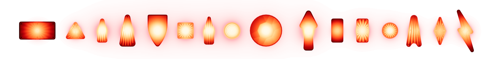
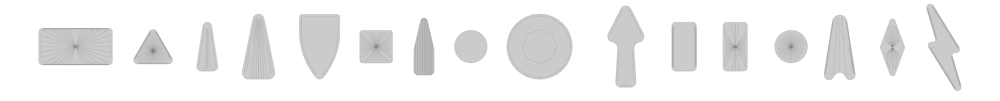

# Inserts

An insert is the plastic window in the playfield that lights up to show a shot, an award, or a game state. What you see is the shape of the plastic, the pattern molded into its underside, the finish on top, and the lamp behind it. VPE handles each of these separately, so an insert can be tuned without modeling it by hand.

Most standard inserts are in the Asset Library: place one in the desired color, map its lamp to the ROM, done. The vast majority of those inserts are created by VPE's procedural insert generator. If you need a size, shape or variant that isn't in the asset library, it's easy to generate new ones (see [Working with Inserts](basics.md)).

## Features

**Shapes:** Triangle, Rectangle, Circle, Banana (a.k.a. Hotdog), Diamond, Flash, Bullet and Arrow, plus Custom outlines from a mesh. All of them get rounded corners, a recessed body, a surrounding channel, a bottom bevel and holes, like molded inserts do. A top-view preview shows the result before it is baked. See [Geometry](geometry.md).

**Patterns:** a plain floor, a radial Starburst, ribs, ripples, a gem or a grid of Stipples. Flash and Custom shapes can have an Engraved Line following the floor outline instead. See [Patterns](patterns.md).

**Materials:** the Insert Hybrid body material is a custom shader that combines surface reflections with a baked internal glow and a virtual image of the lamp underneath, for colored and clear plastic, with up to four lamps. The optional Insert Cover is the clear top: haze, reflections, and a normal map that can follow the playfield's across the edge of the insert. See [Body Material](body-material.md) and [Cover](cover.md).

**Lamps:** the Insert Light component holds the lamps, lets you preview them, move them in the Scene view and map them in *Lamp Manager*, and can drive a real spill light for the ball and the objects above the insert. See [Lighting](lighting.md).

> [!NOTE]
> The mesh generator is part of VPE's main Unity package. The Insert Hybrid and Insert Cover shaders come with the HDRP package and need HDRP; they are not (yet) available in URP.

## Packaging

Inserts travel with the table in VPE's `.vpe` package: the finished mesh, materials, textures and lamp state. Importing the package back into the editor restores the generator settings, custom source meshes and bake data, so the insert stays editable.

> [!NOTE]
> The player uses the finished insert meshes in `table.glb`; it neither regenerates them nor runs Blender. The generator parameters and bake data live in `meta/inserts.json`, a sidecar read only when the package is imported for editing. The hybrid and cover material properties are serialized by VPE's material serialization rather than reduced to a generic glTF material.
