# Insert Lighting

The Insert Light component drives the lamp colors and intensities seen through the body and, optionally, a real light above the insert. Every shape can have one to four lamps; a banana usually wants several along its length.

The body needs a hybrid material with optical maps. If the Inspector reports that they are missing, use *Bake Hybrid and Use Material* (see [baking](baking.md)). The material sets the full-intensity look - The Insert Light component previews and animates it.

The pictures on this page show two clear inserts sharing one material, with a single setting changed at a time and everything else at its default. The upper insert is off and the lower one is lit by an incandescent lamp. Insert Light component settings change only the lit insert; *Number of lamps* and *Position* are stored in the material, so they change both. The spill pictures show a ball next to the lit insert.

## Lamps

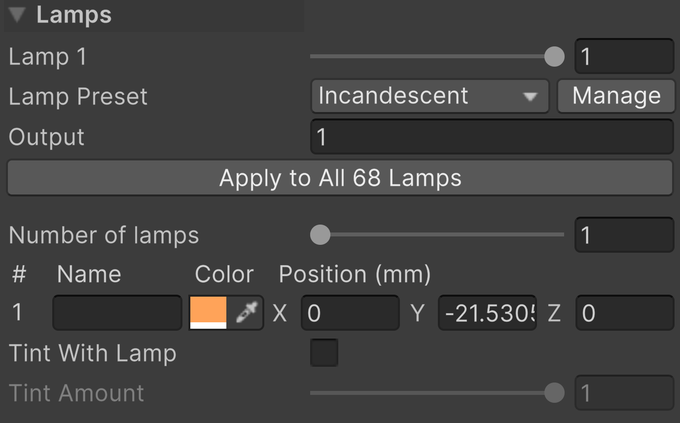

- *Lamp 1* to *Lamp 4* preview each lamp's intensity, from 0, off, to 1, the material's *Max Brightness*. There is one slider per active lamp. In a multi-object selection, a single *Intensity* and *Color* edit the first lamp. During Play mode the game takes over: mapped lamp events overwrite these values.
- *Lamp Preset* is the bulb under the insert, taken from a [lamp preset](presets.md#lamp): it sets the lamps' color, the *Output*, and the fade times. *Custom* keeps the values as they are, following no preset. *Manage* opens the [*Insert Presets*](presets.md) window.
- *Apply to All Lamps* puts the same bulb under every insert of the table. Editing the light's color, output or fades switches *Lamp Preset* to *Custom*. When the preset itself was changed since, *Reset to Preset* takes its values again.
- *Name* is what *Lamp Manager* calls that lamp. Empty names show as *Bulb 1*, *Bulb 2*, and so on; names like Left, Center, and Right make mapping easier.

The other settings are described below, each with how it looks.

| Intensity 0 | 0.5 | 1 (default) |
| --- | --- | --- |
| 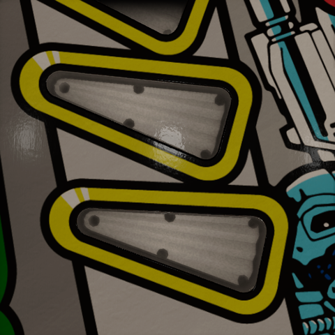 | 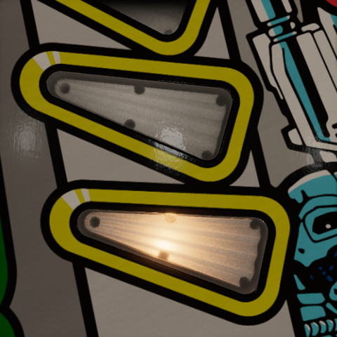 |  |

An insert whose lamp is mapped as *RGB* or *RGB Multi* in [*Lamp Manager*](../lamp-manager.md) is an RGB LED whatever the rest of the table runs: the game drives its color and fading, so no preset is applied to it, and its Insert Light component says so instead of offering a lamp preset. The *Incandescent* and *LED* buttons in [*Lamp Manager*](../lamp-manager.md#lamp-type) switch every other insert at once and also give the table's other lamps the fades. An insert driven by a parent VPE Light component fades with that component's settings instead.

### Output

*Output* is how much light the bulb gives, relative to a #44 filament. It scales every lamp's lit look and the spill alike, at every intensity, without touching the material's *Max Brightness*. The lamp preset sets it: 1 for an incandescent bulb, 3 for an LED.

| 0.25 | 1 (default, incandescent) | 3 (LED) |
| --- | --- | --- |
| 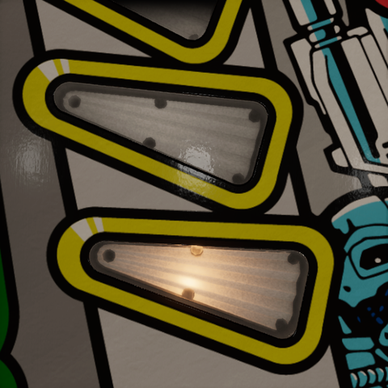 |  | 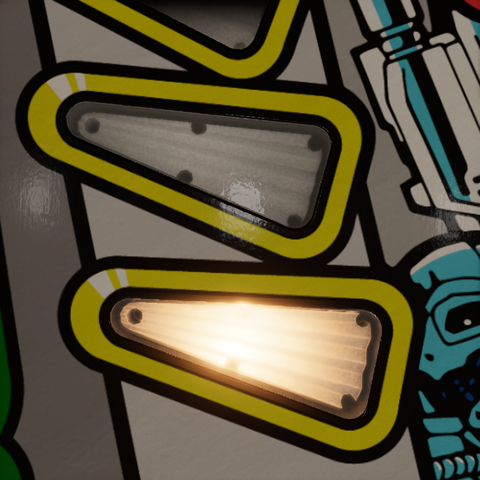 |

An insert that already clips to white does not get whiter with more output; the difference shows in its fall-off, its spill and its bloom.

### Color

*Color* is each lamp's color, independent of the plastic's tint. The lamp preset sets it for every lamp, and each lamp can still get its own RGB mapping. It is the swatch in each lamp's row.

| Incandescent (default) | White | Red |
| --- | --- | --- |
| 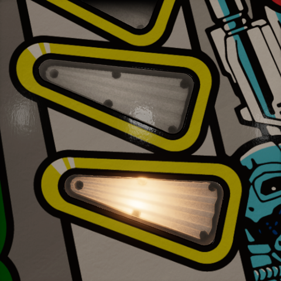 | 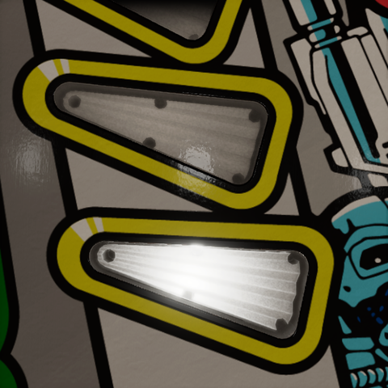 | 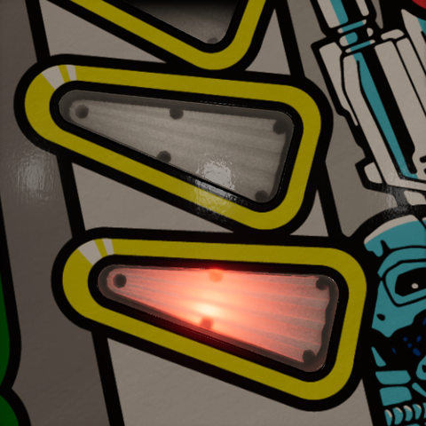 |

A blue insert is the dimmest on an incandescent table: a warm filament has little blue to give, and the blue plastic keeps the rest. Where a table needs it brighter all the same, raise *Max Brightness* in its body material, as described under [Changing a color](customizing.md#changing-a-color).

### Number of lamps

*Number of lamps* is how many virtual lamps the insert has, from 1 to 4, each with its own row, intensity slider, and mapping. The count is stored in the body material; lowering it keeps the disabled lamps' placement for later.

| 1 (default) | 2 | 3 |
| --- | --- | --- |
|  | 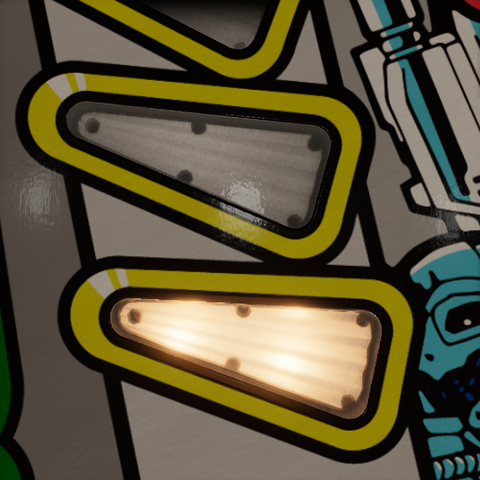 | 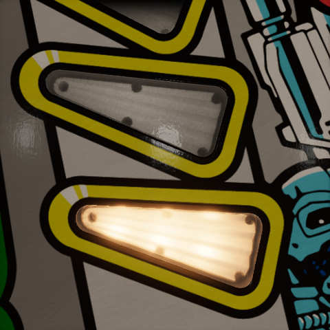 |

Preview one lamp at a time before checking how their bright regions overlap.

### Position

*Position (mm)* is each lamp's place relative to the insert, in local X, Y, and Z, in millimeters. X and Z move the bright region across the insert; the pictures move the lamp along the insert's length. Y is the lamp's depth below the rim, negative downward: a shallow lamp makes a small, hot spot, and a deep one spreads its light evenly and dims it.

| Z −12 mm | 0 (default) | +12 mm |
| --- | --- | --- |
| 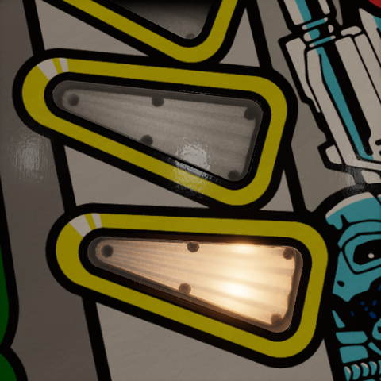 |  | 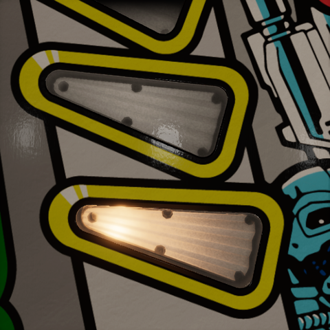 |

Drag the labeled circular handles in Scene view to move lamps in the insert's local XZ plane. The handles keep their Y height; edit Y in the Inspector to move a lamp vertically. Lamp count and position edits are disabled during Play mode and for read-only materials.

*Bulbs*, *Position*, and *Radius* in the [body material](body-material.md#virtual-lamp) refer to the same virtual lamps. *Radius* is shared by the active lamps and is edited in that material Inspector. Lamp placements and radius are material settings, so all inserts sharing the material share that layout.

> [!NOTE]
> **A virtual lamp is a shader image.** Its position describes where the optical shader looks for a bulb. It is not a Unity Light component and moving it does not move the spill light. Colors and intensities are passed as per-renderer material overrides, so different insert objects can animate independently while sharing a material.

### Tint With Lamp

*Tint With Lamp* turns the hue and saturation of the body and the cover's haze toward the lamp's color while it is lit. Off keeps their own hues. *Tint Amount* is how far they turn, from 0 to 1, at full intensity: zero keeps the plastic's own look, one takes the lamp's hue fully where its light reaches.

| Off (default) | Tint Amount 0.5 | Tint Amount 1 |
| --- | --- | --- |
| 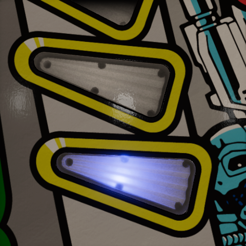 | 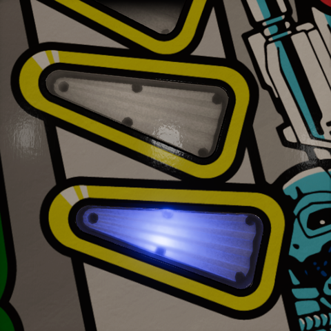 | 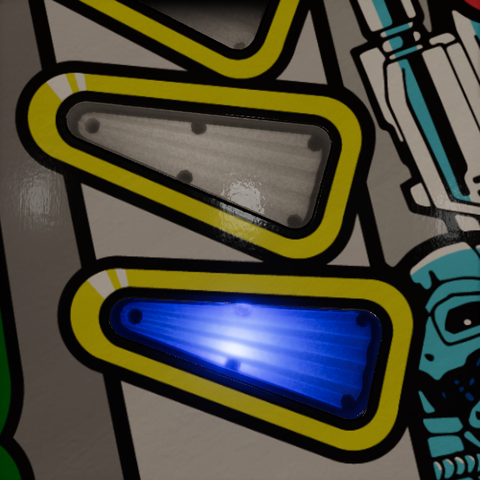 |

Shown with a blue lamp, as an RGB LED would give. The blend keeps the color's brightness. It does not make the body emit on its own, an off lamp leaves the plastic's tint intact, and a white lamp changes nothing. With several colored lamps, the blend follows their positions and *Lamp Spread*, so a long insert can be red at one end and blue at the other. This helps a neutral haze keep the color of an RGB lamp.

## State

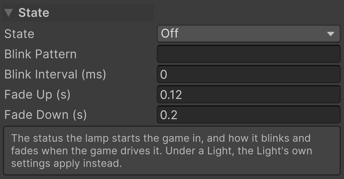

- *State* is the lamp's status when the game starts: *Off*, *On*, or *Blinking*. The game's lamp events take over from there.
- *Blink Pattern* is the blink sequence as ones and zeros, one step per interval, such as 10 or 1100. Empty blinks on and off.
- *Blink Interval (ms)* is how long each step of the pattern lasts, in milliseconds. Zero is a second.
- *Fade Up (s)* is the time the lamp takes to reach full intensity, in seconds.
- *Fade Down (s)* is the time the lamp takes to turn off, in seconds.

The lamp preset sets both fade times. An insert under a VPE Light component uses that component's settings instead.

## Spill

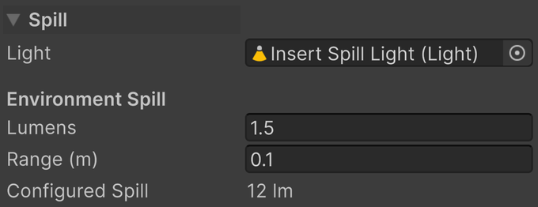

A glowing insert does not by itself light anything around it. A spill light does: a real Unity Light component driven by the active lamps, which lights the ball and whatever else is above the insert.

- *Light* is the Unity Light component driven by the lamps. Its transform remains editable, so you can aim it. Without one, *Add Spill Light* creates a wide spot just under the insert, pointing up through it, and assigns it.
- *Configured Spill* is what the light puts out at the current preview: Lumens × Max Brightness × Output × Insert Brightness × Intensity.
- *Make It a Spot Light* appears for an older point-light spill and turns it into the wide upward spot.

### Lumens

*Lumens* is the spill's output per active lamp at *Max Brightness* 1 and full intensity.

| 0 | 1.5 (default) | 6 |
| --- | --- | --- |
| 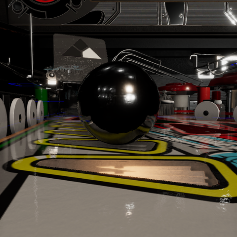 |  | 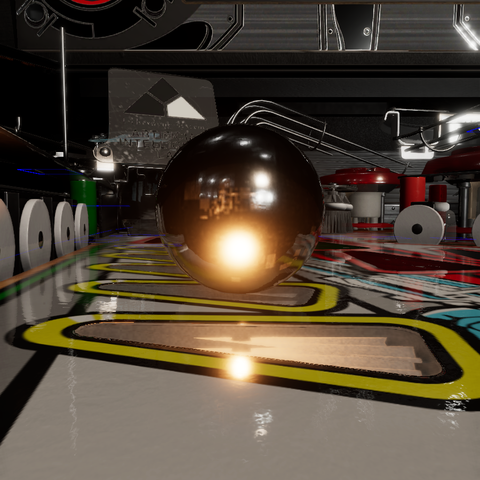 |

The glow under the ball is the spill; the bright spot reflected in it is the insert itself, there at every setting.

For several lamps, the output is **Lumens × Max Brightness × Output × Insert Brightness × sum of active lamp intensities**. Their linear colors are averaged with intensity weights and multiplied by the hue of *Lamp Emission*. The single spill represents their combined illumination; it is not a separate real light for every virtual lamp. Insert Brightness is the table's, set in [Lamp Manager](presets.md#global-controls). For example, Lumens 1.5, Max Brightness 20, Output 1, Insert Brightness 1, and one lamp at 0.5 gives 15 lm. A second lamp at 0.5 brings the output to 30 lm.

### Range

*Range (m)* is how far the spill reaches, in meters, independent of the virtual *Lamp Spread*.

| 0.03 m | 0.1 m (default) | 0.3 m |
| --- | --- | --- |
|  | 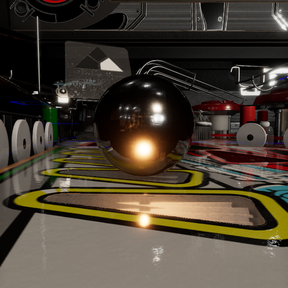 |  |

A ball rolling over an insert is always within a few centimeters of it; a longer range reaches further but makes no difference this close.

> [!NOTE]
> **Default spill setup.** The helper creates a wide spot with a 147° cone, a soft inner cone, a small light source, and no shadows, bounce, or volumetric contribution. Aim and range are important because the light is deliberately broad. Each enabled spill also adds a real light's rendering cost; use it where nearby objects need illumination.

## Mapping

Select the Insert Light component as a destination in [*Lamp Manager*](../lamp-manager.md). A single-lamp insert offers its normal lamp item; an insert with several lamps offers a separately named item for each lamp. Map each game output to the intended item.

Use *Single On/Off* for binary output, *Single Fading* for stepped intensity, and *RGB* for a color-and-intensity output. For separate red, green, and blue game outputs, use *RGB Multi* with the appropriate channel on each mapping; an optional alpha channel drives intensity. The Insert Light component is also available to [Light Groups](../../manual/mechanisms/light-groups.md) and as a [*Wire Manager*](../wire-manager.md) destination.

During Play mode, mapped lamp events overwrite preview drive values. An unmapped Insert Light component can follow a parent VPE Light component, while direct lamp/wire control takes precedence. Without either driver, the Inspector values remain the manual control.

> [!TIP]
> Test the unlit state, each lamp separately, and the combined state. A material that looks good with every lamp at one can still be too bright where colors overlap or too dark at the far end when only one lamp is on.
