# Insert Patterns

A pattern shapes the floor you see through the insert. It changes how the lamp breaks into ribs or facets and how surface detail catches a reflection. *Geometry → Pattern* on the Insert component offers one choice at a time; the selected pattern uses the current outline, channel, and holes. New inserts start with *Starburst*.

Each section below shows the pattern's settings next to the yellow wireframe the Scene view draws while an insert's geometry differs from its last bake, seen at an angle.

> [!NOTE]
> **Pattern shape and material response are separate.** Pattern controls change the source geometry and need baking again. *Surface Normal Strength* and the material's glow controls change how existing maps are read and update immediately. *Facet Contrast* and *Mottle* are specialized for a starburst fan; the Inspector disables them for stipples, engraving, and a plain floor.

## None

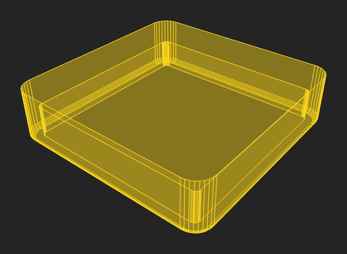
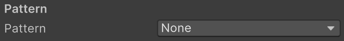

*None* leaves the main floor flat. The channel, bevel, and holes still apply. Baking can still give it rounded edge normals, fine grain, and hybrid optical maps. Choose this when the insert has a smooth interior or when a plain floor makes the lamp appearance you want.

## Starburst

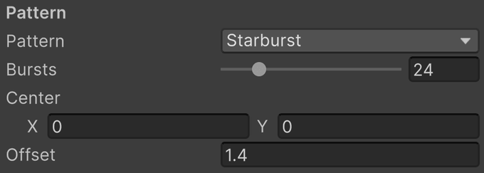

A starburst is a radial wheel of alternating ridges and valleys, clipped to the available floor. The center can sit inside the insert or outside it; a center beyond one end gives the long fan seen in many narrow inserts.

- *Bursts* is the number of bursts around the complete wheel, from 0 to 128. Each burst has two slope sectors. Only the sectors that intersect the insert appear, so this is not a count of visible ribs. Below 2 there is no starburst.
- *Center* is the center of the radial wheel in generator X/Y coordinates, relative to the insert origin, in VPX units. Moving it changes the direction and spacing of ribs on the insert.
- *Centre on the Arc* appears on bananas only. It places *Center* at the center of the banana's arc, making the spokes cross the band.
- *Offset* is the vertical rise and fall of the wheel's rim relative to its center plane, in VPX units. Larger values make steeper facets; zero removes their relief.

The offset is reduced when needed to keep the ridges below the rim and, with a channel, the valleys above the channel floor. If the shape allows little vertical relief, increase the available depths or choose a smaller offset.

<!-- Diagram: patterns-starburst-wheel. Complete wheel overlaid on a narrow insert: Bursts counts the wheel, while only a subset intersects the floor. -->

> [!NOTE]
> **Starburst normals.** The finished mesh retains its slope normals. The bake also stores a tangent-space surface map and an insert-local optical map. Raising *Surface Normal Strength* strongly can exaggerate a facet already present in the mesh. *Facet Flatten* softens the surface reflection ribs without changing how the optical map bends the lamp.

## Ribbed

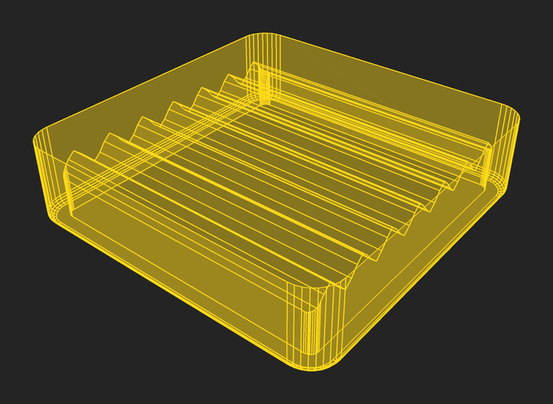
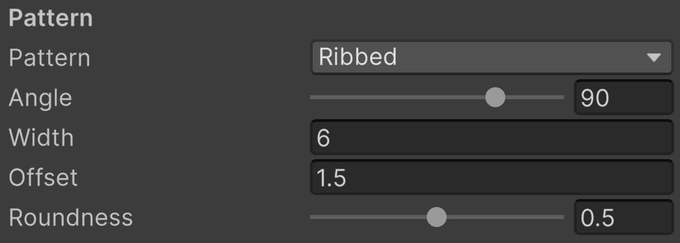

Ribs are parallel ridges and grooves running straight across the floor. Like the starburst, they remain in the finished mesh.

- *Angle* is the direction the ribs run, in degrees from the insert's X axis, from −180° to 180°. Zero runs them along X, 90° along Y.
- *Width* is the distance from ridge to ridge, in VPX units. A ridge runs through the insert's origin.
- *Offset* is how far the ridges rise above and the grooves drop below the floor, in VPX units.
- *Roundness* is how far the ridges and grooves are rounded over, from 0 to 1. Zero leaves sharp creases; one rolls them over like a molded wave.

The offset is limited the same way as the starburst's: the ridges stay below the rim and the grooves above the channel floor.

## Rings

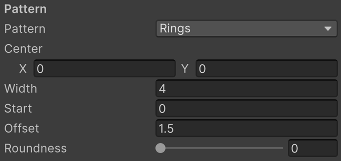

Rings are concentric ridges and grooves around a center, the round counterpart of ribs. They remain in the finished mesh.

- *Center* is where the rings are centered, relative to the insert's origin, in VPX units.
- *Centre on the Arc* appears on bananas only. It places *Center* at the center of the banana's arc, so the rings run along the band.
- *Width* is the distance from ridge to ridge, in VPX units. The center is a ridge, and the first groove lies half a width out.
- *Start* is how far out from the center the rings begin, in VPX units, leaving a flat disc in the middle at the ridges' height. It is rounded to whole widths, so the rings lie where they would without the disc.
- *Offset* is how far the ridges rise above and the grooves drop below the floor, in VPX units.
- *Roundness* is how far the ridges and grooves are rounded over, from 0 to 1. Zero leaves sharp creases; one rolls them over like a molded wave.

## Gem

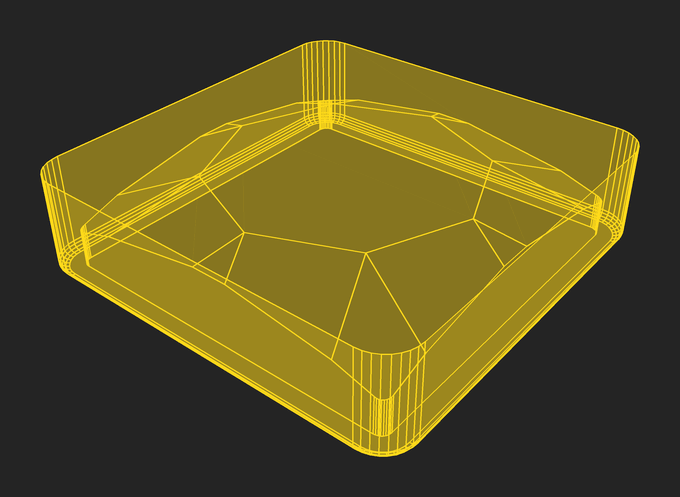
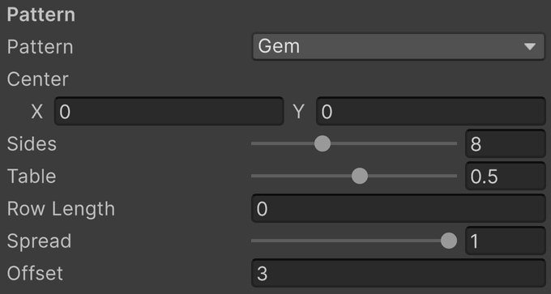

*Gem* cuts the floor like a gemstone: a flat table in the middle with rows of triangular facets zigzagging out to the edge. The facets remain in the finished mesh.

- *Center* is where the gem is centered, relative to the insert's origin, in VPX units.
- *Sides* is the number of sides of the table, and of the kites around it, from 4 to 16. A brilliant has eight.
- *Table* is how far out the table's corners lie, as a share of the way from the center to the edge, from 0.05 to 0.9.
- *Row Length* is how far out each further row of facets starts beyond the last, measured from the table's sides, in VPX units. Zero runs one row of facets straight from the table to the edge; a length adds a ring of facets at every such step, as a brilliant's crown has.
- *Spread* is how evenly the facets meet the edge, from 0 to 1. At zero the lines from two neighboring corners meet the edge at one point; at one every line meets it as far from the next as from the last, and the facet off each side runs out to the edge as a trapezoid.
- *Offset* is how far the table rises above and the girdle drops below the floor, in VPX units.

## Engraved Line

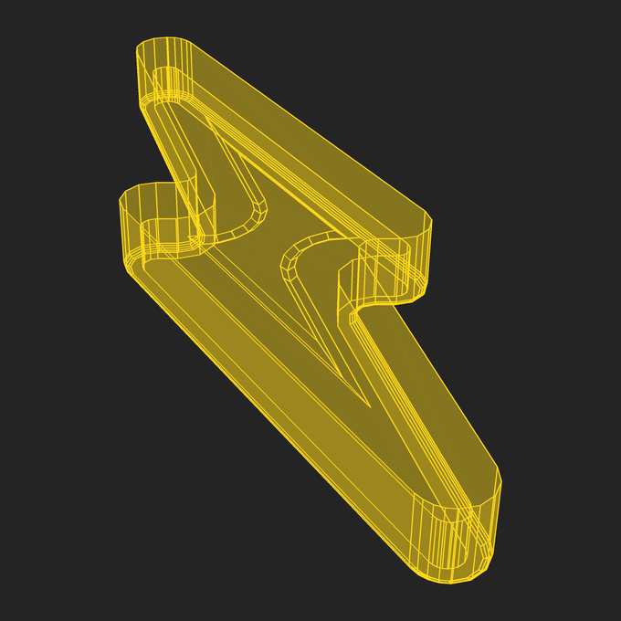
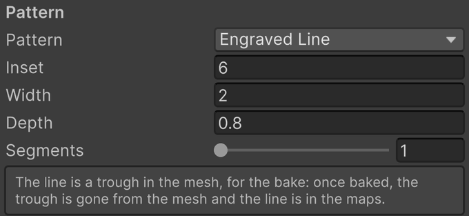

*Engraved Line* makes a narrow trough following an inset version of the floor's outline. As the outline is inset, its flat ends can close into points and its inward notches widen. On a flash, the result resembles a lightning bolt engraved into the plastic; a custom shape follows its own floor outline.

- *Inset* is the distance from the main floor edge to the middle of the line, in VPX units. It is applied inside the channel's already inset floor.
- *Width* is the full width across the trough, in VPX units. A wider line needs more clearance from the floor edge.
- *Depth* is the depth of the line at its middle, in VPX units. Zero removes its vertical cut.
- *Segments* is the number of steps down each side of the trough, from 1 to 16. One gives a V cut; additional steps approximate a rounded floor. The bake's *Edge Bevel* can soften the V cut.

*Engraved Line* is available for *Flash* and *Custom* shapes only. If the inset line cannot fit or crosses itself at a narrow part of the outline, the Inspector reports why. Reduce *Inset* when the inner outline collapses; increase clearance or reduce *Width* when its outer edge reaches beyond the floor.

<!-- Diagram: patterns-engraving. Flash outline, channel edge, and line center; cross-section showing Width, Depth, and Segments. -->

> [!NOTE]
> **Replacing the trough.** The engraved middle keeps its projection from above through UV packing. After a fitting bake, VPE replaces the middle's trough geometry with a plain island carrying the same projected maps. Changing the line brings its source geometry back until the next bake. This differs from stippling, which bakes onto a separate plain body target from the start.

## Stippled

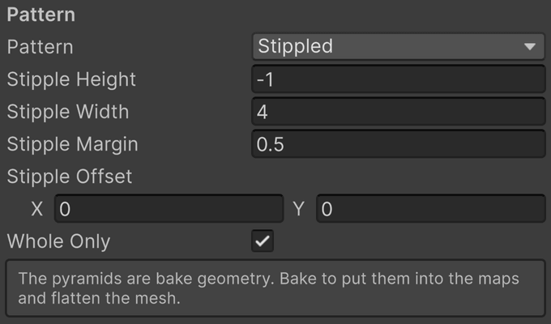

Stipples are square pyramids arranged on a grid. Each has a square base and four triangular slopes meeting at an apex. A flat margin separates neighboring bases. The grid is centered on the floor's bounding box. After baking, the pyramids live in the normal and optical maps, and the mesh is the plain body.

- *Stipple Height* is the apex height above the main floor, in VPX units. Taller pyramids produce steeper normals. A negative height sinks the stipples into the floor instead. It is reduced to keep the apex below the rim, or a sunken stipple within the surface.
- *Stipple Width* is the length of each side of the square base, in VPX units. Larger bases make a coarser pattern.
- *Stipple Margin* is the flat gap between adjacent bases, in VPX units. Zero allows neighboring bases to touch. Grid pitch is *Width* plus *Margin*.
- *Stipple Offset* moves the grid away from centered on the floor, in VPX units.
- *Whole Only* builds only the stipples that fit on the floor whole. Off, every stipple the floor reaches is built and cut off at the outline.

With *Whole Only* on, a pyramid is omitted if its base would overlap a rounded boundary or a hole. Changing *Width* or *Margin* can therefore change which pyramids fit as well as their density. The grid is limited to 4096 candidate cells across the floor's bounding box, including cells that are later omitted. If it exceeds that limit, rebuilding reports an error; increase *Stipple Width* or *Stipple Margin*.

<!-- Diagram: patterns-stipple-cell. Side and top views dimensioning Height, Width, and Margin; a hole with intersecting cells omitted. -->

> [!NOTE]
> **Plain bake target.** Blender receives the pyramids as its detailed source and the ordinary no-pattern body as its bake target. The target owns the UV atlas and tangent frames returned to Unity. Once the bake fits, that target is the displayed body, with exactly the same triangle positions as the corresponding no-pattern body. Detail remains in the normal and optical maps rather than in a flattened grid of source triangles.

## Shared detail

*Bottom Bevel* shapes the actual body where the outer wall meets the channel. *Edge Bevel* rounds sharp edges in the baked surface normals, including pattern edges. *Grain Strength* and *Grain Size* add fine baked surface texture. These apply across patterns, so they are documented once under [Geometry](geometry.md#body-channel-and-bottom-bevel) and [Baking](baking.md#bake-settings).

The material's *Grain* is a separate procedural variation in color and emission. It needs no rebake. Its *Facet Contrast*, *Mottle Amount*, and *Mottle Size* are starburst-specific, while the virtual lamp's refraction reads the optical normals of every pattern. See [Body Material](body-material.md).
