# Insert Presets

VPE's inserts shader has many properties that can be more easily driven with presets. There are three different types of presets. Each one answers a different question, and no setting belongs to more than one of them.

| Preset | The question | Shared by | Where to set it |
| --- | --- | --- | --- |
| [**Lamp**](#lamp) | What kind of bulb is under the insert? | The whole table | The *Lamp Preset* row on each Insert Light component, or the *Incandescent* / *LED* buttons in *Lamp Manager* for every insert at once |
| [**Color**](#color) | What color is the plastic? | All inserts of one color | The color squares under *Presets* on the Insert component |
| [**Look**](#look) | How is the plastic molded, and how does it handle light? | All inserts of one style | The *Clear Plastic* / *Colored Plastic* buttons under *Presets* on the Insert component |

## Where presets are set

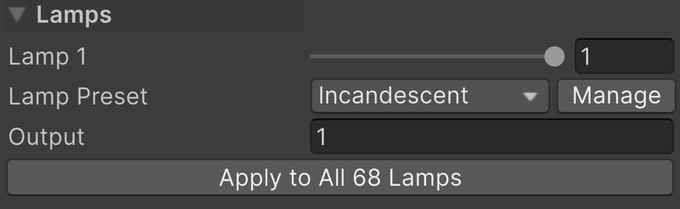

The lamp preset lives on the *Insert Light* component, at the top of its *Lamps* section. *Lamp Preset* picks the bulb, and *Output* shows how much light it gives. *Apply to All Lamps* puts the same bulb under every insert of the table.

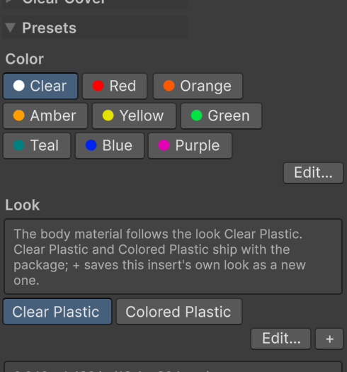

The color and look presets live on the *Insert* component, in its *Presets* section. A click on a color square or a look button applies it. The lit one is the preset the insert follows.

Every preset row has a *Manage* button that opens *Pinball → Insert Presets* on the matching tab.

## Lamp

The lamp preset is the bulb: the color of its light, how much light it gives, and how quickly it comes on and goes out. A whole table runs on one kind of bulb, so you normally set it once, from [*Lamp Manager*](#global-controls).

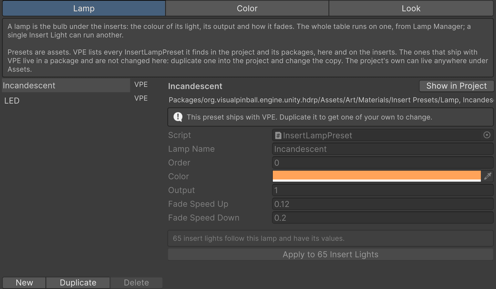

The *Lamp* tab of the *Insert Presets* window lists the lamps VPE found in the project and its packages, and where each one lives. The ones that ship with VPE are read-only: *Duplicate* copies one into your project to change, *New* starts one from defaults, and *Delete* removes one of the project's own. Below the values, the window counts the Insert Light components that follow the selected lamp, and *Apply* puts its values back under any of them that drifted.

| | Off | On |
| --- | --- | --- |
| **Incandescent** | 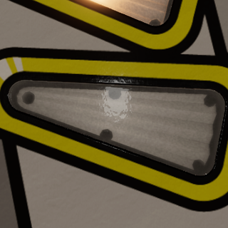 | 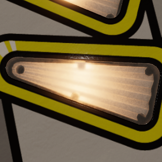 |
| **LED** | 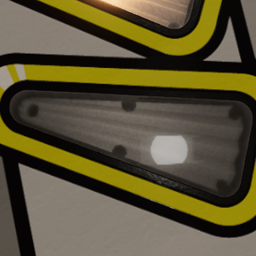 | 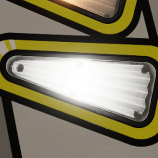 |

The bulb makes no difference while the lamp is off. Lit, *Incandescent* is a warm filament like a #44 or #555: a cream-colored core that fades to amber toward the edges, and a lamp that takes a moment to warm up and cool down. *LED* is a neutral white at three times the output, on and off instantly. There is no warm or cool white LED to choose from: the switch is there to see a table under either kind of bulb while you tune it, not to pick a shade.

**To set:** pick it from *Lamp Preset* on the Insert Light component, or for the whole table from [*Lamp Manager*](#global-controls). *Custom* keeps the light's values as they are, following no preset.

**To change:** edit the values from *Settings* in *Lamp Manager*, and every Insert Light component following the preset takes the change right away. Edited on the *Lamp* tab, the values reach those components when you press *Apply*. Editing the color, output or fades on an Insert Light component itself switches its *Lamp Preset* to *Custom*.

**To add:** press *Duplicate* or *New* on the *Lamp* tab, or choose *Create → Pinball → Insert Lamp Preset* in the Project window. The new lamp appears next to *Incandescent* and *LED* everywhere they do. Keep a little of every channel in its color: a lamp with a channel at zero shifts hue instead of fading to white when it gets bright.

## Color

The color preset is the plastic: its tint, the color of the lamp light that comes through it, how bright it gets, and the color of the clear cover on top. Every insert of one color shares it.

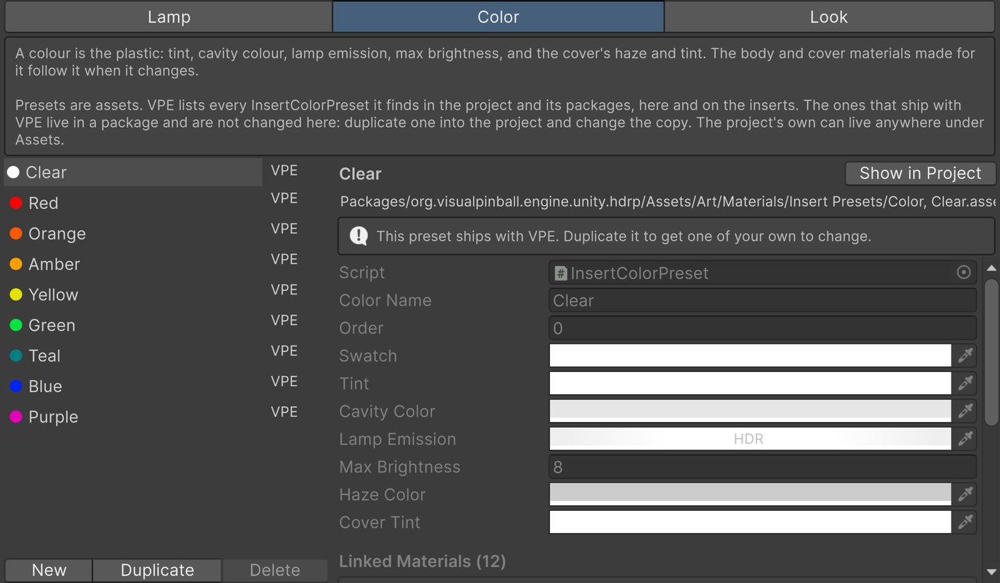

The *Color* tab works like the *Lamp* tab. Below the values, *Linked Materials* lists the body and cover materials that follow the selected color.

| | Clear | Red | Green | Blue |
| --- | --- | --- | --- | --- |
| **Off** |  | 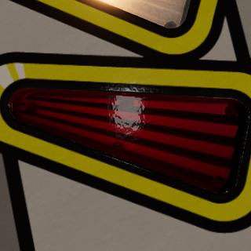 | 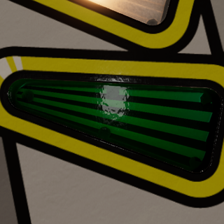 | 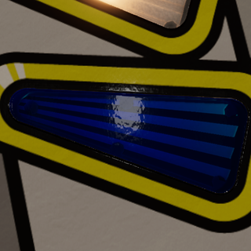 |
| **On** | 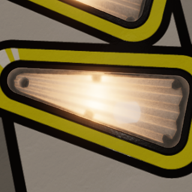 | 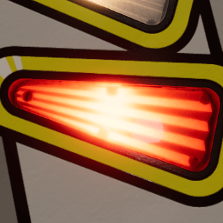 | 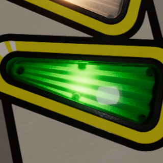 | 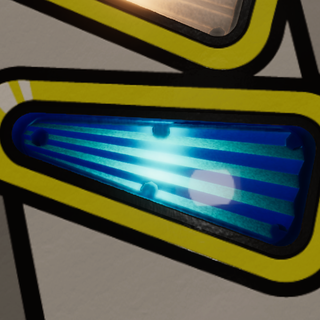 |

Off, each color shows as tinted plastic over the dark cavity. On, it shows the lamp through that plastic. Colors differ a lot in how much light they let through, which is why *Max Brightness* is part of the color preset: a blue insert needs more of it than a clear one to come up comparably bright.

**To set:** click a color square under *Presets* on the Insert component. VPE looks for a material of that color next to the insert's current one and assigns it; if there is none, it makes one and links it to the preset.

**To change:** edit the values on the *Color* tab, or Ctrl-click a color square to highlight its asset and edit it in the Inspector. Every linked material follows along. **A linked material shows the preset's values grayed out:** they're changed in the preset, for every insert of that color, or the material is unlinked first by setting its *Color Preset* to none, which keeps the values it has.

**To add:** press *Duplicate* or *New* on the *Color* tab, or choose *Create → Pinball → Insert Color Preset*. Give it a name and a swatch, and a new square appears on every insert. To fill it with the colors of an insert you have tuned, pick it as the *Color Preset* of that insert's body and cover materials and choose *Copy to* when VPE asks whose values to keep.

A color preset holds these values:

| Value | Meaning |
| --- | --- |
| *Color Name* | The color's name, used in the button's tooltip, in the names of the materials made for it, and to find them. Keep it distinct and stable. |
| *Order* | Where its button appears; lower comes first, names break ties. |
| *Swatch* | The button's color. It doesn't change the material. |
| *Tint* | The body's *Tint*. |
| *Cavity Color* | The body's *Cavity Color*, seen through the clear share of the plastic. Its effect depends on *Clarity*. |
| *Lamp Emission* | The body's *Lamp Emission*: the color of the plastic lit from below by a white lamp. The lamp preset's color multiplies it. |
| *Max Brightness* | The body's *Max Brightness*. Colors differ in how bright they look through the plastic, so each has its own. |
| *Haze Color* | The cover's *Haze Color*. It needs a cover and some *Opacity* to show. |
| *Cover Tint* | The cover's *Tint*: the color the light takes on its way up through the plastic. Keep a little of every channel in it, and in *Lamp Emission*, so a bright lamp fades to white instead of shifting hue. |

## Look

The look preset is how the plastic is molded and how it treats light: how clear it is, how glossy, how the facets catch the lamp, how strong and how wide the bulb reads, how much glow spreads through the body. *Clear Plastic* and *Colored Plastic* ship with VPE.

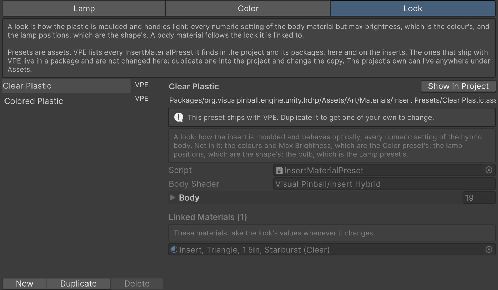

On the *Look* tab, *Body* holds the material values the look sets, and *Linked Materials* lists the body materials that follow it.

| | Clear Plastic, off | Clear Plastic, on | Colored Plastic, off | Colored Plastic, on |
| --- | --- | --- | --- | --- |
| **Clear color** | 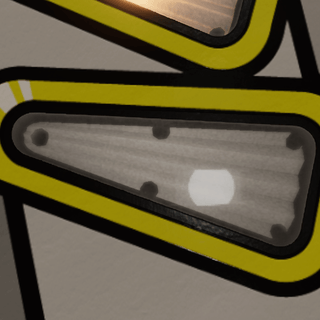 | 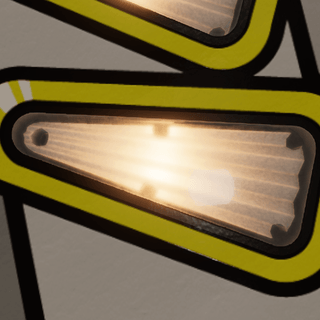 | 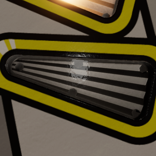 | 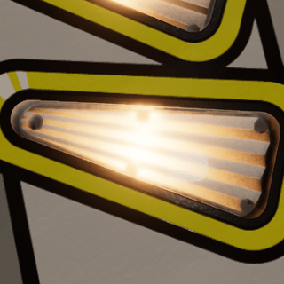 |
| **Red color** | 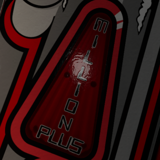 | 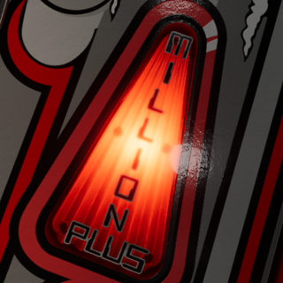 | 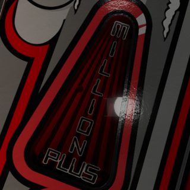 | 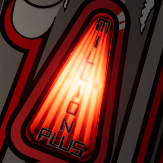 |

*Clear Plastic* lets you see the cavity under the insert, flattens the ribs so they don't flicker under the room light, and spreads the lamp out softly. *Colored Plastic* is opaque until the lamp comes on, keeps the ribs crisp, and gives the bulb a tight, strong image. The wrong look on a plastic shows why both exist: clear plastic under the Colored look goes dark and striped, red plastic under the Clear look goes pale and milky.

**To set:** click *Clear Plastic* or *Colored Plastic* under *Presets* on the Insert component. The body material takes the look's values and keeps following the preset from then on. If the material already had values of its own, you are asked whether to copy them into the look first.

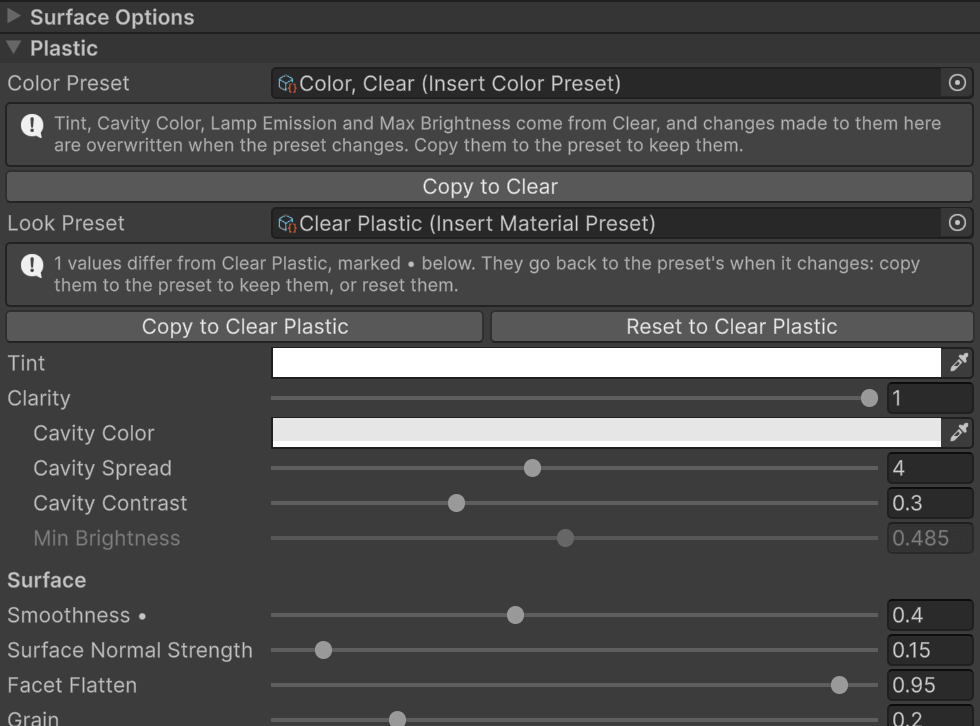

**To change:** most of the tuning happens here, so the body material's inspector tells you where every value came from. Hover over a field and its tooltip starts with *From the Look preset Clear Plastic*, or *From the Color preset Red* for the values the color owns. Change a field and a • appears next to its name: the value is now the material's own, and the preset will overwrite it the next time the preset changes. The *Look Preset* row at the top of the *Plastic* section counts these edits. *Copy to Clear Plastic* makes them part of the look, so every insert following it gets them too. *Reset to Clear Plastic* throws them away.

**To add:** press *Duplicate* or *New* on the *Look* tab, and the new button appears on every insert. To fill it with the values of an insert you have tuned, click the new look on that insert and choose *Copy to* when VPE asks whose values to keep.

A look preset stores *Body Shader*, the shader it was captured from, and *Body*, the list of the material's numeric values it sets: each entry's *Name* is the shader property, *Kind* its type, and *Float* or *Vector* its value. Colors and *Max Brightness* belong to the color preset, and a look never sets them.

## Brightness

The brightness of an insert is controlled by the lamp's output, the color's maximum brightness, the table's insert brightness, and the light's intensity, multiplied together:

> **Lamp Output × Color Max Brightness × Insert Brightness × Intensity**

The lamp's *Output* is the bulb: an LED kit gives about three times the light of a filament. The color's *Max Brightness* is the plastic: how much of that light gets through. *Insert Brightness* is the table's overall level, which the player app lets its user change (see [Global controls](#global-controls)). *Intensity* is the game: the lamp's level between off and full. When an insert is too bright or too dim, the bulb changes every insert on the table, the color changes every insert of that color, and the intensity is up to the game.

An insert whose center already shows pure white cannot get any whiter on screen. Turning any of these up shows at the edges of the insert, in what it throws onto the ball and the playfield, and in its bloom.

## Global controls

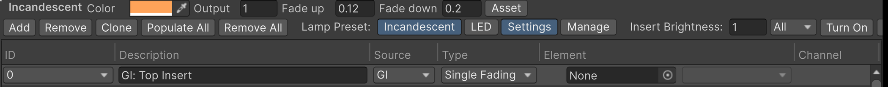

*Pinball → Lamp Manager* sets the bulb for the whole table. Press *Incandescent* or *LED* next to *Lamp Preset:* in the toolbar, and every insert takes the bulb, and every other lamp on the table takes its fade times, so the whole machine warms up and cools down, or snaps, as one. The lit button is the lamp the inserts follow; none is lit when they follow different lamps.

Flashers are left alone, and so is any lamp mapped as *RGB* or *RGB Multi*: the game drives those, color and fading, which makes them RGB LEDs whatever the rest of the table runs. Their *Insert Light* component says so instead of offering a lamp preset.

*Settings* shows the lit lamp's color, output, fade up and fade down above the toolbar. Whatever you change there goes into the preset and under every insert of the table right away. *Asset* highlights the preset in the Project window, and *Manage* opens the *Lamp* tab of the *Insert Presets* window.

*Insert Brightness:* is a factor on every insert of the table, on the lens and the spill light alike. It's the table's default: it goes into the `.vpe` package, and the player starts the table with it. Players can change it per table under *Table Settings* in the pause menu, and go back to your value with *Reset*. Use it to balance the inserts against the rest of the table; use the lamp preset and the colors to balance them against each other.

All of this works while the game is running in the editor, without pausing it, so you can judge a table under both bulbs mid-game.
