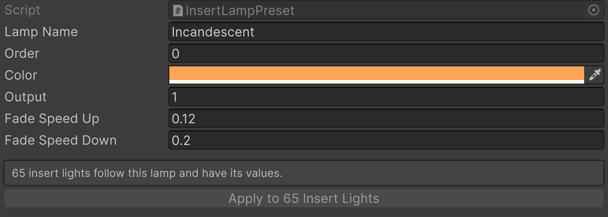
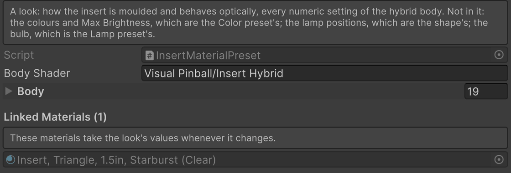

# Insert Presets

VPE's inserts shader has many properties that can be more easily driven with presets. There are three different types of presets. Each one answers a different question, and no setting belongs to more than one of them.

| Preset | The question | Shared by | Where to set it |
| --- | --- | --- | --- |
| [**Lamp**](#lamp) | What kind of bulb is under the insert? | The whole table | The **Lamp** row on each Insert Light, or the **Incandescent** / **LED** buttons in Lamp Manager for every insert at once |
| [**Color**](#color) | What color is the plastic? | All inserts of one color | The color squares under **Presets** on the insert |
| [**Look**](#look) | How is the plastic molded, and how does it handle light? | All inserts of one style | The **Clear Plastic** / **Colored Plastic** buttons under **Presets** on the insert |

Every preset row has an **Edit…** button that opens **Pinball → Insert Presets**: the lamps, colors and looks VPE found, each with where it lives. The ones that ship with VPE are read-only there; **Duplicate** copies one into your project to change, **New** starts from defaults, and the project's own can be deleted again.

## Lamp

The lamp preset is the bulb: the color of its light, how much light it gives, and how quickly it comes on and goes out. A whole table runs on one kind of bulb, so you normally set it once, in Lamp Manager.

| | Off | On |
| --- | --- | --- |
| **Incandescent** |  |  |
| **LED** |  |  |

The bulb makes no difference while the lamp is off. Lit, **Incandescent** is a warm filament like a #44 or #555: a cream-colored core that fades to amber toward the edges, and a lamp that takes a moment to warm up and cool down. **LED** is a neutral white at three times the output, on and off instantly. That is the whole difference between the two shipped presets. There is no warm or cool white LED to choose from, because the switch exists to see a table under either kind of bulb while you tune it, not to pick a shade.

**Setting it.** Open **Pinball → Lamp Manager** and press **Incandescent** or **LED**. Every insert takes the bulb, and every other lamp on the table takes its fade times, so the whole machine warms up and cools down, or snaps, as one. Flashers are left alone, and so is any lamp mapped as **RGB** or **RGB Multi**: the game drives those, color and fading, which makes them RGB LEDs whatever the rest of the table runs. Their Insert Light says so instead of offering a lamp. This works while the game is running in the editor, without pausing it, so you can judge a table under both bulbs mid-game. A single insert can be switched on its own from the **Lamp** row of its Insert Light.

**Changing it.** Press **Settings** next to the lit lamp button in Lamp Manager. The four values appear above the toolbar: color, output, fade up and fade down. Whatever you change there goes into the preset and under every insert of the table right away. **Asset** highlights the preset in the Project window if you prefer to edit it in the Inspector, which also lists how many Insert Lights follow it. An Insert Light whose values no longer match its preset says so and offers **Reset to Preset**.

**Adding one.** Choose **Create → Visual Pinball → Insert Lamp Preset** anywhere in your project, give it a name, and it appears next to Incandescent and LED everywhere they do. Keep a little of every channel in its color; a lamp with a channel at zero shifts hue instead of fading to white when it gets bright.

## Color

The color preset is the plastic: its tint, the color of the lamp light that comes through it, how bright it gets, and the color of the clear cover on top. Every insert of one color shares it.

| | Clear | Red | Green | Blue |
| --- | --- | --- | --- | --- |
| **Off** |  |  |  |  |
| **On** |  |  |  |  |

Off, each color shows as tinted plastic over the dark cavity. On, it shows the lamp through that plastic. Colors differ a lot in how much light they let through, which is why **Max Brightness** is part of the color preset: a blue insert needs more of it than a clear one to come up comparably bright.

**Setting it.** Click a color square under **Presets** on the insert. VPE looks for a material of that color next to the insert's current one and assigns it; if there is none, it makes one and links it to the preset.

**Changing it.** Ctrl-click a color square (Cmd-click on macOS) to highlight its asset, then edit it in the Inspector. Every material linked to the preset follows along. It also works the other way around: tune the body or cover material of one insert until it is right, then press **Copy to Red** at the top of the material's inspector to put those values into the preset and, through it, into every other insert of that color.

**Adding one.** Choose **Create → Visual Pinball → Insert Color Preset**, give it a name and a swatch, and a new square appears on every insert. The quickest way to fill in its values is to apply it to one insert, tune the materials, and press **Copy to**.

## Look

The look preset is how the plastic is molded and how it treats light: how clear it is, how glossy, how the facets catch the lamp, how strong and how wide the bulb reads, how much glow spreads through the body. Two looks ship with the package.

| | Clear Plastic, off | Clear Plastic, on | Colored Plastic, off | Colored Plastic, on |
| --- | --- | --- | --- | --- |
| **Clear color** |  |  |  |  |
| **Red color** |  |  |  |  |

**Clear Plastic** lets you see the cavity under the insert, flattens the ribs so they don't flicker under the room light, and spreads the lamp out softly. **Colored Plastic** is opaque until the lamp comes on, keeps the ribs crisp, and gives the bulb a tight, strong image. Put the wrong look on a plastic and you see why there are two: clear plastic under the Colored look goes dark and striped, red plastic under the Clear look goes pale and milky.

**Setting it.** Click **Clear Plastic** or **Colored Plastic** under **Presets** on the insert. The body material takes the look's values and keeps following the preset from then on; the lit button shows which look it follows. If the material already had values of its own, you are asked whether to copy them into the look first.

**Changing it.** This is where most of the tuning happens, so the body material's inspector tells you where every value came from. Hover over a field and its tooltip starts with *From the Look preset Clear Plastic*, or *From the Color preset Red* for the handful of values the color owns. Change a field and a **•** appears next to its name: the value is now the material's own, and the preset will overwrite it the next time the preset changes. The **Look Preset** row at the top of the Plastic section counts these edits and offers two buttons. **Copy to Clear Plastic** makes them part of the look, so every insert following it gets them too. **Reset to Clear Plastic** throws them away.

**Adding one.** Tune an insert until it looks right, then press **+** next to the look buttons. VPE saves the body's values as a new look, links the material to it, and the new button appears on every insert. A look's own inspector lists the materials that follow it and how many values each has changed.

## How bright an insert gets

Three things decide it, multiplied together:

**Lamp Output × Color Max Brightness × Intensity**

The lamp's **Output** is the bulb: an LED kit gives about three times the light of a filament. The color's **Max Brightness** is the plastic: how much of that light gets through. **Intensity** is the game: the lamp's level between off and full. When an insert is too bright or too dim, one of these three is the knob to turn, and the only question is which: the bulb changes every insert on the table, the color changes every insert of that color, and the level is up to the game.

One thing to know before turning any of them up: an insert whose center already shows pure white cannot get any whiter on screen. The extra light shows at the edges of the insert, in what it throws onto the ball and the playfield, and in its bloom.
