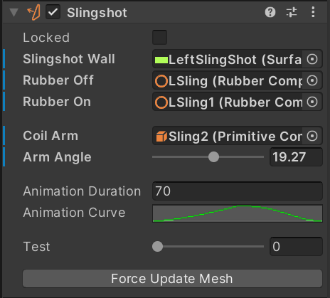
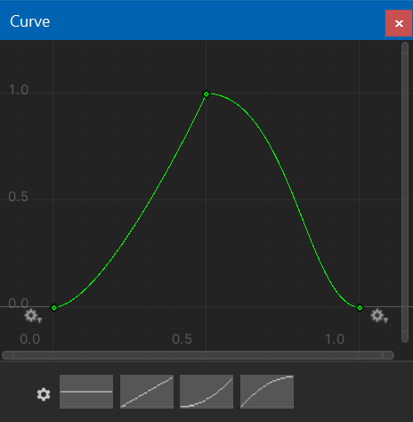

# Slingshots

Slingshots are most commonly located just above the flippers. They usually consist of two "blade" switches on the inner side of a triangular rubber. Between the switches there is a coil driven arm that propels the ball away from the slingshot when either switch closes.

Visual Pinball doesn't have an explicit slingshot element. Instead, it relies on walls with a segment marked as *slingshot*, which generates an additional force being applied to the ball when the segment is hit. However, the rubber animation is up to the table script to implement.

VPE does provide a slingshot component that implements the rubber animation during runtime. This allows for functional slingshots without any additional code. However, this approach isn't ideal and will be replaced with a proper slingshot element in the future.

# Setup

### Slingshot Wall

In order to trigger the animation, the slingshot component needs a reference to the wall which has one of the control points set to *slingshot*. 

### Rubbers

VPE animates the control points of the rubber by interpolating between a start position to an end position and then back to the start over the duration of the animation. 

To set the start and end positions of the control points, we reference two rubber elements (which must have the same number of control points.) In the inspector, *Rubber Off* indicates the rubber representing the start position, and *Rubber On* the end position.

> [!NOTE]
> In VPX, tables often come with three rubbers elements that are toggled in order to fake an animation. When using VPE's slingshot component, you can delete the rubber at mid position, since only the start and end rubbers are used. The interpolation is calculated in real time depending on the speed of the slingshot.

### Coil Arm

On physical machines, the rubber is moved by an arm attached to the coil. VPE can simulate the movement of that arm by rotating a primitive across the X-axis. In the *Coil Arm* field, a reference to the primive can be set, and the total angle of rotation under *Arm Angle*.

### Animation

The animation has two parameters: The duration in milliseconds, and the curve. The curve represents the position in function of time and covers both directions of travel. This allows non-linear movement of the rubber.

### Test

With the test slider you can easily preview how the rubber and arm are animated.

# Howto

## Set Up a Slingshot from an Imported Table

This howto uses the blank table, but other tables should be similar. Usually, slingshots consist of three rubbers for the animation, plus a wall for the physics. We need the following elements:

1. The wall with a segment set to *slingshot*
2. The rubber at idle position
3. The rubber at *activated* position
4. Optionally, the coil arm that pushes the rubber

Note that both rubbers *must* have the same number of drag points. This is because during the animation, the rubber is linearly interpolated between the two drag points positions, which isn't possible if the number differs. When converting a table from Visual Pinball, that means that you may need to add additional drag points to the rubber at idle position.

### 1. Identify and clean up the elements

Zoom in to the slingshot you want to set up. You'll probably want to temporily hide the plastic that covers up the rubbers and the wall. Find the rubber at idle position and at activated position. Delete the rubber in-between, we don't need that one.

Note the names of those rubbers. Here it's `LSling` and `LSling1`. Also look for the the coil arm, which is called `Sling2`, as well as wall that acts as the physical slingshot, here `LeftSlingShot`.

> [!Video https://www.youtube.com/embed/rL2uZyYXBHk]

### 2. Add additional control points if necessary

Now, since `LSling1` is bent and thus contains three additional control points, we'll add the same points to `LSling`.

We can now also can hide the meshes of the rubbers.

> [!Video https://www.youtube.com/embed/Yie1Pby8iGs]

### 3. Add the slingshot component

In the Toolbox, click on the *Slingshot* icon, which will create a new element in the scene. Rename it and link the elements we've identified in step 1:

- *Slingshot Wall* links to `LeftSlingShot`
- *Rubber Off* links to `LSling`
- *Rubber On* links to `LSling1`

The slingshot component is now able to create the mesh. The animation can be tested with the *Test* slider.

> [!Video https://www.youtube.com/embed/421gesRScYo]

### 4. Setup the coil arm animation

Since the rubber is pushed inside by the arm, the arm should be animated along with the rubber. This can be a bit fiddly, since the arm should be as close to the rubber as possible without clipping through it.

Move the *Test* slider all to the right, and play with the *X-Rotation* of the coil arm. Once you're happy, copy the angle to the clipboard. Then, select the slingshot. In the inspector, set the following fields:

- *Coil Arm* links to the primitive, in our case `Sling2`.
- *Arm Angle* is the angle when the coil is enabled. Paste the angle you've copied before.

Now, when moving the *Test* slider, the arm should animate along with the rubbers.

> [!Video https://www.youtube.com/embed/Q1jeJHRIziM]

### 5. Wrap-up and test

Before final testing, there are two things left to do:

1. Select the coil arm and disable the collider
2. Enable the plastic we hid in step 1.

Then hit play and have a game!

> [!Video https://www.youtube.com/embed/dNS4YPdRXTc]

# Physical Slingshot

The component above animates rubbers around a wall segment that Visual Pinball marks as a slingshot; the kick itself is the wall's velocity boost. VPE also has a *physical* slingshot that works the way the real assembly does: a blade switch closes when the rubber is pushed in far enough, a coil fires, and its arm kicks the ball that is still in front of the rubber. It needs a guided rubber with the [compliant rebound](xref:rubbers#compliant-rebound) enabled, because the switch reads the cord's deflection.

## Requirements

- A **Guided** rubber in **Physical** collision mode with **Compliant Rebound** enabled, whose outcome in the Rubber Collider inspector is **Deformable**. The guided path and the rebound are refit and rebaked on their own, in the editor and when the game starts.
- The slingshot binds to one free span of that rubber, identified by the two guides it runs between. A rubber on exactly two posts has two identical spans and cannot be bound; a slingshot rubber runs around three posts.
- Optionally a **Rubber Deformation Renderer** on the rubber and a coil arm primitive, for the animation.

## Creating One

The physical slingshot is a component of its rubber, and a rubber has at most one. Select the rubber. In the Scene view, every free span the slingshot can bind to is highlighted, with an **Add Slingshot** button at its midpoint. Click the button on the span that faces the ball, usually the long side of the triangle, and VPE adds a *Rubber Slingshot* component to the rubber, bound to that span, with two switch zones and sensible arm defaults. From then on the bound span is marked *Slingshot* and every other span offers **Move Slingshot Here**, which re-binds it. Below the buttons, one hint names the first thing the rubber still lacks, such as a rest length or the compliant rebound. You can add the slingshot before fixing that, but it cannot fire until you do.

The same is available from the menu: **GameObject → Pinball → Add Physical Slingshot To Rubber** opens a small window that lists the free spans by their guides.

Either way, the slingshot needs a *Slingshot Actuator* asset. If the project has none, one is created with default values at `Assets/Slingshot Actuator.asset`. The current version does not consult it, see below. The slingshot inspector diagnoses the same things afterwards: rest length not configured, rebound material missing, bound span not eligible.

## Switch

Two **Switch Zones** sit on the span at authored positions (`0` at the first guide, `1` at the second). When a ball deflects the cord, VPE evaluates the V-shaped deflection profile at each zone; a zone whose deflection reaches its **Close Deflection** closes and stays closed for its **Minimum Closed Time**. The two zones are combined into the slingshot's one logical switch, `slingshot_switch`, which the gamelogic engine and player wires see. *Open Deflection* is kept for a future version and has no effect.

Because a physics switch can close and open again within one rendered frame, the slingshot stretches every pulse it delivers to the gamelogic engine to at least **Minimum Switch Pulse** milliseconds, so emulated hardware never misses it. Player wires get the raw edges.

## Coil and Kick

The coil, `slingshot_coil`, can be energized two ways:

- **Self Wired** (on by default): the closing switch energizes the coil itself after **Wire Delay** milliseconds of simulation time, for **Self Wire Pulse** milliseconds, entirely inside the physics simulation. This is how a real slingshot is wired, and it is deterministic.
- From the gamelogic engine or a player wire, like any other coil. Turn the self wire off when the game logic is supposed to control the slingshot.

When the coil energizes, the arm kicks every ball in front of the rubber that is within its **Arm Tip Travel** minus **Arm Rest Clearance** of the cord and inside **Arm Half Width** of the **Arm Contact Position**, adding **Kick Speed** along the rubber's outward direction, scaled down toward the edges of the arm. The ball that closed the switch is kicked even if it has already bounced a little further away, as long as the coil fires within **Kick Window** milliseconds of the closure; that stands in for the time a real ball spends pressed into the rubber. A coil that fires with nothing in reach only animates, and a ball that hits the rubber while the coil is not commanded rebounds passively.

The **Actuator** asset stays assigned and packaged for a future physical arm model; this version does not consult it.

## Animation

With a Rubber Deformation Renderer on the rubber, every hit twangs the cord inward and every coil firing pushes it outward at the arm position over the renderer's **Animation Duration** on its **Kick Curve**. The **Coil Arm** primitive rotates from **Visual Rest Angle** to **Visual Fired Angle** on the same curve, in the same simulation clock, so rubber and arm stay in phase.

To align the arm without starting a game, drag the **Kick** slider under *Preview* at the bottom of the Rubber Slingshot inspector. It poses the arm between its rest and fired angle and, with a renderer on the rubber, bends the cord outward at the arm's contact position by the arm's travel. Leave the slider up while you adjust **Visual Fired Angle**, **Arm Contact Position** or **Arm Tip Travel**, then set it back to zero. Nothing of the preview is saved, and it ends by itself when the game starts or the scene is saved.

## Limitations

The cord's collision geometry never moves: the rebound is instantaneous, a second ball never sees a deflected cord, and the kick is a velocity change rather than an arm pushing rubber. Game logic that queues switches on its own thread, such as the PinMAME integration, may still miss a pulse under heavy load; the self wire does not depend on it.
